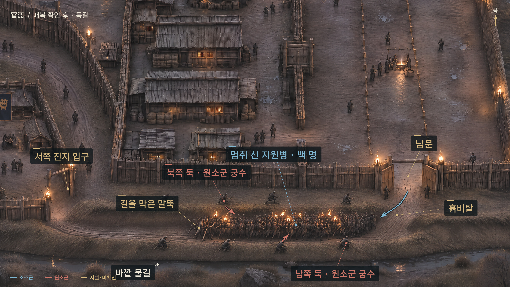

# 10장 관도 · 목책 (완성 원고)

- 사건, 갈래, 선택지 값은 지금 게임과 같습니다. 옛 대본 `docs/대본/대본_10장_목책.md`를 1~9장과 같은 문체로 다시 썼습니다. 기준은 `AI_작업_지침표.md`, 확인은 `tools/문장검사.py`.
  - 10장의 단계는 **"아는 대로 오는가?"** 입니다. 주인공은 9장에서 이 밤을 책 순서대로 확신했다. A선(여포가 죽은 판)은 장합이 책처럼 정면으로 오지만 목책 안 창고 앞까지 들어온다. B선(여포를 살린 판)은 문에 여포가 서 있어서 장합이 문을 치지 않고, 오소 소식 뒤 저수가 조조의 깃발 수법을 되돌려 주인공의 피난문을 노린다. 원고는 그 뜻을 풀어 말하지 않는다.
- 앞 장에서 이어지는 것
  - 9장 A선: `a10_warn`(name이면 조홍이 궁수 스물과 널빤지 두 짐을 붙였다) · `a10_risk=camp` · `a10_jinqi`(stand면 진기가 목책 기둥에 귀를 댄다).
  - 9장 B선: `b11_warn`(name·dir·lvbu·none) · `b11_speak`(yes면 조공의 명으로 여포에게 기병이 붙는다) · `b11_iseok`(stand면 이석이 문을 지킨다) · `b9_stir`.
  - 9장 공통: `의심 8 이상`이면 조공이 조홍에게 "무엇부터 겁내는지 보라" 하고 떠났다. 조공은 순우경이 취해 있지 않으리라 봤고, 원소는 허유가 사라진 뒤 오소에 순찰을 늘리라 명했다.
- 동료 정책: 왕삼·조노·소칠은 관도 전까지 죽지 않는다. 이 장에서 쓰러지거나 끌려가도 산다(`endure=last`면 왕삼·조노가 머리를 다쳐 쓰러졌다 깨어난다, `decoy=sochil`이면 소칠은 포로로 남는다). 옛 대본의 생존 조건과 그 대체 줄은 지웠다.
- **원고 형식 (새 형식)**: 1~9장과 같습니다. A선은 `〔!4장 살림〕`, B선은 `〔4장 살림〕`. 이 장은 A선과 B선의 절이 모두 다르다. `#### 이어서`는 다시 같이 읽는 자리, `/`는 화면을 끊는 자리. `{fitK}`·`{reserve}`·`{halfReserve}`는 게임이 채우는 숫자 자리.
- 표지(괄호 안은 게임 깃발): `4장 살림` · `3장 조앙 생존` · `3장 전위 생존` · `3장 dw=tell`(`toldDianwei`) · `caoang=heart`(`caoangAlly=heart`) · `의심 8 이상`(`ccWatch`)
  - 9장 값을 그대로 쓰는 깃발: `a10_jinqi=stand`(`jinqiWall=stand`) · `b11_iseok=stand`(`iseokGate=stand`) · 널빤지 두 짐(`boards`) = `a10_warn=name 또는 의심 8 이상` · 7장 `jw`(`dianweiTrust`)
- 갈래 값
  - A선: `prep=brace`·`inner` / `relief=all`·`half` / `position=front`·`breach` / `attention=signals`·`men` / `wsHand=honest`·`ask`·`cold`(`prep=inner`)
  - B선: `lvgate=danger`·`trust` / `ambush=send`·`keep` / `dplan=decoy`·`pull` / `fake=jono`·`sochil`·`wangsam`(`dplan=decoy`) / `jxsrc=book`·`heard`·`idea` / `decoy=wounded`·`sochil` / `empty=all`·`half` / `truth=tell`·`lie` / `flag=now`·`wait` / `endure=back`·`last` / `gate=open`·`hold`(`endure=back`) / `rescue=ask`·`self`(`endure=back`) / `night=lvbu`·`wounded`·`ledger`
- 말투: 조홍 → 나 해라체. 순유·가후 → 나 하오체. 나 → 윗사람 합쇼체, 왕삼·조노 하오체, 소칠·마오·덕배·모팔·병사 반말. 여포 → 조홍 하오체, 나 반말. 장합 → 고람 하오체, 부장 해라체. 저수·곽도 → 원소 합쇼체.
- 게임과 다른 곳 (게임 코드에는 아직 반영 전)
  - B선 원소군 막간: 척후가 "문에 여포, 서쪽 진지에 관우, 동쪽 안쪽 목책에 작은 문"을 보고하고, 장합이 그래서 문을 치지 않는다(삽과 도끼). 오소 소식 뒤 저수가 깃발 수법을 되돌리자고 하고 원소가 받아들인다. 장합이 잡아 둔 포로(마오 또는 소칠)를 앞세운 들것 행렬을 꾸린다.
  - B선 피난문 신호(깃발 둘을 엇갈려 들고 징 세 번)를 저녁 밥 줄에서 외운다.
  - B선 `gate` 선택의 계기가 아군 피난에서 포로를 앞세운 위장 귀환으로 바뀌었다. `gate=open`이면 피난문이 반쯤 뚫리고, 여포가 돌아오면서 막힌다. 단서: `decoy=wounded`면 마오가 짝이 맞는 신을 신고 있다, `decoy=sochil`이면 소칠이 "짐꾼은 군막을 세지 않습니다"라고 외친다.
  - B선 `endure=last`: 왕삼·조노가 쓰러졌다 깨어난다. 위장 행렬은 신호 없이 문 앞에서 막힌다.
  - B선 `gate`: 위장 행렬이 장합군과 싸우는 척하며 문 앞에 틈을 낸다. 주인공은 단서를 알아채고도 고른다. `open`이면 위장한 자가 문 안 짐더미에 불을 던지고, 여포가 그 불을 보고 돌아선다. `open`으로 들어온 부상병은 새벽에 살아 있다.
  - B선 `flag=now`: 본대가 들어오지 않자 순유가 선봉만 가두는 징을 친다.
  - B선 오소 막간은 장합이 피난문 자리를 짚는 데서 끊는다. 위장 행렬의 모양은 피난문 앞에서 주인공과 같이 처음 본다. 주인공은 들것 메는 어깨와 쇠 소리로 무게가 사람 무게가 아님을 알아챈다. 장합 본대 막간(목책 밖)은 지웠다.
  - B선 `truth=lie`: 새벽 점호에서 병사가 교대병이 어디로 들어왔는지 묻는다.
  - B선 `dplan`: 뜻이 "지금 엉성하게라도 꾸민다(decoy) / 목책부터 다 고치고 나서 꾸민다(pull)"로 바뀌었다. 값은 같다.
  - B선 `endure=last`: 왕삼·조노가 쓰러져 점호와 먹 갈기는 방패병 십장 탁삼이 맡는다. 소칠·마오 소식은 문 안 군관이 전한다.
  - 저수 막간의 기록이 "先南·先己"에서 "명을 따름 / 명을 줄임"으로 바뀌었다.
  - 조홍의 `의심 8 이상` 대사를 9장 조공 대사에 맞췄다.
  - A선·B선 끝에 주인공이 죽간에 한 줄 적는다. B선은 `endure`에 따라 다르다.
- 이름: 방패병 십장 **탁삼**(A선 `prep=inner`에서 왕삼 대신 지휘, B선 `endure=last`에서 점호).
- B선 공간 (작업용 표, 원고에 풀어 쓰지 않는다)
  - 동쪽 바깥 목책(내 구간) → 안으로 첫 번째 말뚝 줄 → 두 번째 말뚝 줄 → 안쪽 목책과 **피난문** → 창고 구역.
  - 내 진지 = 바깥 목책과 안쪽 목책 사이. 남북 끝에 본영 안으로 가는 통로가 하나씩 있다(순유가 닫는 "양쪽 입구"). 남 통로 끝이 본영 남문.
  - 서쪽 진지 = 본영 남서쪽 외곽 진지(관우 구간, 고람이 친다). 본영 남문을 나가 창고 구역 남쪽 목책을 따라 쌓은 두 흙둑 사이 길(둑 길)로 간다. 둑 바깥에 물길이 흐른다. 창고 남쪽 목책에는 발판이 없다.
  - 안쪽 목책은 세 토막이다. 가운데에 피난문, 양 끝 틈이 북쪽·남쪽 통로. 남문은 내 진지 남쪽 목책에 난 바깥문이다. 순유가 통로를 닫을 때 남문에도 빗장을 건다.
- 그림 (B선): 지도는 게임에서 장 첫머리 지도 버튼으로 연다. `img/10B_map_all.jpg`(교전 전, 두 지원로) · `img/10B_map_east.jpg`(말뚝 줄, 통로, 피난문, 남문) · `img/10B_map_dike.jpg`(매복 전 둑길). 본문 일러는 `ambush` 선택 앞 한 장(`img/10B_ill_ambush.jpg`).
  - 장합이 주머니에서 고람에게 가는 가장 빠른 길은 피난문 → 창고 구역 → 서쪽 목책. 위장 행렬은 둑 길에서 쫓겨 온 지원병인 척 본영 밖을 돌아, 장합이 연 바깥 목책 틈으로 들어와 피난문 앞에 선다.
- 밤 시각(B선): 조공 출발 초경 / 장합 출발 이경 / 매복·가짜 진 이경~삼경 / 마오·소칠 잡힘 삼경 / 오소 소식 사경 / 두 번째 말뚝·피난문 사경 끝 / 여포 오경 / 새벽.

---

## 동쪽 목책 〔!4장 살림〕

*〈장소〉 같은 밤 · 관도 본영 동쪽 목책*

조공의 행렬이 사라진 뒤 나는 다시 목책에 올랐다. 북문 너머에서 말발굽 소리가 끊겼다. 떠나기 전 조홍은 내 구간의 교대병 수를 묻고, 예비는 한 번에 다 쓰지 말라고 했다.

책대로라면 장합은 이 밤에 온다. 그런데 해 질 녘에 돌아온 전령은 원소 진영에 횃불이 늘지 않았다는 말만 하고 갔다. 기억대로라면 장합은 벌써 움직였어야 했다. 조홍은 아직 자리를 뜨지 말라고만 했다. 〔a10_warn=none〕

떠나기 전, 전위가 내 어깨에 손을 얹고 갔었다. 나도 모르게 허리를 폈다. 전위가 웃었다. "어깨 좀 내려라." 그가 손을 뗀 뒤에도 나는 그 자세 그대로 서 있었다. 〔3장 전위 생존, 3장 dw=tell, jw≠deny〕

목책 아래에 조홍이 보낸 궁수 스물이 먼저 와 있었다. 목수들은 널빤지를 두 짐이나 더 지고 왔다. 〔a10_warn=name〕

조앙이 투구끈을 매며 발판 아래로 왔다. 다른 구간을 돌고 오는 길이라 했다. 부상자를 층계로 내리는 일은 자기 사람들이 맡겠다고 했다. 〔3장 조앙 생존, caoang=heart〕

조홍이 목책 아래까지 와서 나를 불렀다. 〔a10_warn≠name, 의심 8 이상〕

**조홍**: "주공께서 네가 무엇부터 청하는지 보라 하셨다. 무엇이 필요하냐. 사람은 못 준다. 물건이면 준다." 〔a10_warn≠name, 의심 8 이상〕
**나**: "널빤지를 더 주십시오. 발판도 고쳐야 하고, 들것이 내려갈 층계도 넓혀야 합니다. 지금 있는 것으로는 한쪽밖에 못 합니다." 〔a10_warn≠name, 의심 8 이상〕
**조홍**: "두 짐 보내마. 더는 없다. 어느 쪽을 먼저 고칠지는 네가 정해." 〔a10_warn≠name, 의심 8 이상〕

얼마 뒤 목수들이 널빤지를 두 짐 지고 왔다. 〔a10_warn≠name, 의심 8 이상〕

조홍에게 사람을 보내 널빤지를 더 청했다. "있는 걸로 해라." 한마디만 돌아왔다. 〔a10_warn≠name, !의심 8 이상〕

목책 안쪽에 붙인 나무 발판은 밟을 때마다 삐걱거렸다. 우리 구간에 층계는 두 곳뿐이었다. 들것 하나가 내려오면, 올라가던 병사들은 몸을 모로 세워 비켜야 했다.

조노와 함께 부상자 천막을 돌았다. 낮에 괜찮다던 병사 하나는 어깨가 부어 창을 들지 못했다. 다시 세어 보니 싸울 수 있는 사람은 {fitK}이었다. 그 숫자를 적어 순유에게 보냈다.

그중 {reserve}을 교대병으로 빼 두었다. 조노가 발판 아래에 그들을 앉혔다. 위에서 쓰러지는 자리를 메울 사람들이었다. 물은 열다섯 살 모팔이 맡았다.

왕삼이 흔들리는 발판을 밟아 봤다. 그가 체중을 싣자 맞은편 널 끝이 손가락 하나만큼 들렸다. 받침 하나에 금이 가 있었다. 목수들은 남은 널빤지와 굵은 줄을 들고 내 명을 기다렸다.

발판 위에서 소칠이 내려다보며 말했다.

**소칠**: "나리. 횃불이 늘었습니다. 아직 멉니다. 저쪽 진영 앞에서 줄을 서는 것 같습니다."

올라가 봤다. 적진 앞에 횃불이 길게 늘어서 있었다. 불빛 사이로 사다리 끝이 보였다. 조금 더 쉴 수 있으리라는 생각을 접고 왕삼을 불렀다.

이석은 층계 아래에 빈 들것을 모아 두고 있었다. 멀리 나르지는 못해도, 내려오는 사람을 받아 눕히는 일은 하겠다고 했다. 〔a9_rescue=go〕

**왕삼**: "이 받침, 사다리 서넛 받으면 꺾이오. 그런데 층계도 들것이 못 돌아 나오오. 널은 한쪽 몫뿐이오." 〔a10_warn≠name, !의심 8 이상〕
**왕삼**: "이 받침, 사다리 서넛 받으면 꺾이오. 그런데 층계도 들것이 못 돌아 나오오. 널은 남는데 손이 모자라오. 저것들 오기 전에 한쪽밖에 못 끝내오." 〔a10_warn=name 또는 의심 8 이상〕

목수가 망치를 쥔 손으로 땀을 닦았다. 발판 밑의 금 간 받침과 좁은 층계를 번갈아 봤다.

**[선택]** (값 이름: prep)
- ▸ **발판부터 보강한다** — 여럿이 함께 사다리를 밀어낼 수 있다. 다친 사람이 내려갈 길은 좁다 (`brace`)
- ▸ **들것이 내려갈 층계부터 넓힌다** — 다친 사람은 빨리 빠진다. 금 간 발판 한 칸은 비워 두고 싸운다 (`inner`)

#### 〔prep=brace〕

**나**: "발판부터 고치시오. 목수는 밑에서 일하고, 위는 우리가 방패로 가리겠소."

왕삼과 병사들이 방패를 내밀었다. 목수는 그 밑에 몸을 웅크리고 버팀대를 묶었다. 망치질이 내 발바닥까지 울렸다.

**왕삼**: "횃불이 가까워지오. 사다리도 따라오고."

목수가 마지막 매듭을 조였다. 왕삼이 방패를 목책 위로 더 밀어 올렸다.

**왕삼**: "됐소. 이제 여럿이 올라와도 버티오."

층계로 내려가는 길은 사람이 어깨를 돌려야 지나갈 만큼 좁았다. 부상자는 둘이 붙들어 내려보내라고 조노에게 일렀다.

조홍이 보낸 널빤지가 남아, 층계 한쪽도 넓힐 수 있었다. 들것 하나는 지나갈 만했다. 〔a10_warn=name 또는 의심 8 이상〕

#### 〔prep=inner〕

**나**: "층계를 넓혀 주시오. 들것을 들고도 내려올 수 있게. 발판에서는 한곳에 몰리지 말고."

목수들이 층계에 널빤지를 덧댔다. 조노는 병사 둘을 데리고 빈 들것을 옮겨 봤다. 모서리에 걸렸다.

**조노**: "빈 들것도 걸리는데 사람까지 누우면 돌리지도 못하겠소. 모서리 기둥부터 깎읍시다."

왕삼이 금 간 받침 위의 발판에 줄을 둘렀다. 그곳은 비우게 하고, 양옆의 병사들에게 사다리가 걸리면 함께 밀어내라고 일렀다. 널을 덧대지 못한 발판 밑에서는 받침이 계속 삐걱거렸다. 〔a10_warn≠name, !의심 8 이상〕

왕삼이 금 간 받침 위의 발판에 줄을 둘렀다. 그곳은 비우게 하고, 양옆의 병사들에게 사다리가 걸리면 함께 밀어내라고 일렀다. 남은 널로 받침에 버팀목 하나를 덧댔지만, 망치질을 다 끝내지는 못했다. 〔a10_warn=name 또는 의심 8 이상〕

**소칠**: "사다리를 들고 나옵니다. 궁수들도 따라옵니다."

조노가 마지막 널을 밟아 보고 올라왔다. 소칠은 방패 아래로 몸을 낮췄다.

#### 이어서

/

북이 울렸다.

한 번 울리고, 답하듯 남쪽에서 한 번 더 울렸다. 횃불 줄이 한꺼번에 움직였다.

**나**: "방패 올려! 궁수, 시위 걸어! 교대병은 앉은 채로 기다려!"

왕삼이 같은 말을 발판 끝까지 전했다. 조노가 아래에서 교대병들에게 자리를 지키라고 외쳤다.

그러고 나서 숨을 서른 번 쉬는 동안 아무 일도 없었다.

진기가 목책에 귀를 붙인 채 손을 들었다. 〔a10_jinqi=stand〕

**진기**: "왼쪽에서 나무 끄는 소리가 납니다. 북이 멎을 때마다 들립니다." 〔a10_jinqi=stand〕

그쪽 어둠을 살폈다. 낮게 움직이는 사다리 끝이 잠깐 보였다. 궁수들을 왼쪽으로 돌렸다. 〔a10_jinqi=stand〕

모팔이 발판 밑을 돌며 물주머니를 하나씩 올렸다. 나는 횃불보다 그 사이에 보이는 사람들을 살폈다. 밝은 곳을 벗어나면 투구도 방패도 금방 어둠에 묻혔다. 적이 얼마나 많은지는 알 수 없었다.

목책 앞 백 걸음에서 횃불이 멈췄다.

저쪽에서 화살이 먼저 넘어왔다. 통나무에 박히는 소리가 비처럼 이어졌다. 우리 궁수가 답했다. 발판이 울렸다.

횃불 사이에서 사다리 여섯이 앞으로 나왔다. 넷이 우리 구간 가운데로, 둘이 왼쪽 끝으로 왔다. 가운데 넷 가운데 하나는 금 간 받침 바로 앞이었다.

왼쪽 사다리를 메던 병사들이 화살을 피해 흩어졌다. 사다리 하나가 옆으로 기울었다. 〔a10_jinqi=stand〕

사다리가 목책에 부딪혔다. 나무가 울리더니 꼭대기에 손 하나가 올라왔다. 손가락이 나무를 움켜쥐고, 그 아래에서 투구 쓴 얼굴이 솟았다.

창을 내질렀다. 갑옷 가장자리에서 날이 미끄러졌다. 다시 찔렀을 때는 창끝이 박혔다. 밀어 넣던 창대가 손 안에서 멈췄다. 적병의 입이 벌어졌다. 그는 창대를 붙든 채 떨어졌고, 내 몸도 목책 밖으로 딸려 나갔다.

**왕삼**: "창을 놓으시오!"

왕삼이 허리띠를 잡아당겼다. 손을 폈다. 창은 적병과 함께 사라졌다. 목책 안으로 주저앉았는데도 손바닥에는 아직 창대가 눌리는 것 같았다.

방패병 하나가 내가 서 있던 자리를 메웠다. 나무를 움켜쥐던 적병의 손가락이 자꾸 눈앞에 떠올랐다.

**조노**: "창 걱정은 마시오. 받으시오."

조노가 새 창을 내 손에 밀어 넣었다. 내가 창대를 움켜쥔 걸 보고서야 손을 뗐다. 내 자리를 막던 병사 옆에 붙어 창을 내밀었다.

보강한 발판 위로 병사들이 달려왔다. 여럿이 사다리 하나에 달라붙어 밀었다. 이번에는 발판이 꺼지지 않았다. 발판 아래 목수가 묶어 둔 줄이 팽팽해졌다. 〔prep=brace〕

사다리가 거듭 부딪히자 금이 갔던 받침이 꺾였다. 줄 쳐 둔 발판이 기울며 옆의 널까지 잡아당겼다. 옆 칸의 병사 하나가 미끄러졌다. 왕삼이 그를 붙들어 끌어올렸다. 그 바람에 왕삼의 발이 널 사이에 끼었다. 왕삼의 겨드랑이를 잡아 끌어냈을 때 그는 왼발을 딛지 못했다. 〔prep=inner, a10_warn≠name, !의심 8 이상〕

사다리가 거듭 부딪히자 금이 갔던 받침이 꺾였다. 덧대다 만 버팀목 덕에 발판이 한꺼번에 내려앉지는 않았다. 그래도 기운 널 사이로 옆 칸의 병사 하나가 미끄러졌다. 왕삼이 그를 붙들어 끌어올렸다. 그 바람에 왕삼의 발이 널 사이에 끼었다. 왕삼의 겨드랑이를 잡아 끌어냈을 때 그는 왼발을 딛지 못했다. 〔prep=inner, (a10_warn=name 또는 의심 8 이상)〕

넓혀 둔 층계로 왕삼을 내려보냈다. 들것이 걸리지 않고 내려갔다. 왕삼의 자리에는 방패병 십장 탁삼을 세웠다. 탁삼은 대답 대신 왕삼의 방패 끈을 제 팔에 감았다. 〔prep=inner〕
층계를 내려온 들것 앞을 무너진 버팀목이 막았다. 이석이 앉은 채 목재를 밀어내고 들것 모서리를 받쳤다. 운반병들이 발을 고쳐 디딜 때까지 놓지 않았다. 〔prep=inner, a9_rescue=go〕

적이 처음 물러났을 때 병사 하나가 주저앉았다. 모팔이 내 입에 물주머니를 댔다. 삼키다 사레가 들려, 모팔이 등을 두드렸다. 물주머니를 돌려주며 물러나는 적의 등 뒤를 봤다. 아직 한 번도 앞에 나오지 않은 부대가 방패를 세운 채 서 있었다. 물러난 병사들이 그 부대 뒤로 들어가 앉았다. 새로 온 병사들은 방패를 든 채 목책을 보고 있었다.

남쪽에서는 여전히 함성이 그치지 않았다. 조홍의 군관이 층계를 뛰어 올라왔다.

**군관**: "장군의 명입니다. 남쪽 목책에 고람의 군사가 올라붙었습니다. 여기 교대병 {reserve}을 데려오라 하셨습니다."

조노가 아래에서 손을 멈췄다. 쉬고 있던 교대병들이 명을 듣고 일어났다. 그들을 모두 보내면 당장 우리 부대를 대신할 병력이 없었다. 남쪽에는 이미 적이 목책 위에 올라섰다고 했다.

**[선택]** (값 이름: relief)
- ▸ **교대병을 전부 보낸다** — 남쪽이 먼저 무너질 판이다. 우리는 교대 없이 다음 공격을 맞는다 (`all`)
- ▸ **절반만 보낸다** — 저 방패들이 곧 온다. 명을 줄였다고 조홍에게 그대로 전한다 (`half`)

**나**: "데려가시오. 장군께 전해 주시오. 물러난 적 뒤에 새 부대가 남아 있소. 아직 공격하지는 않았지만, 여기 병력을 더 빼기는 어렵겠소." 〔relief=all〕

군관이 교대병들을 데리고 갔다. 목책 위에서 지친 사람이 내려오자 옆의 병사들이 그가 맡았던 곳까지 창을 뻗었다. 조노는 아래에 남아 다친 사람을 옮겼다. 〔relief=all〕

**조노**: "다친 사람은 내려오시오. 버틸 만한 사람만 조금 더 버텨 주시오." 〔relief=all〕

방패를 들어 빈 곳을 막았다. 처음 사다리를 밀어내던 팔에 다시 힘을 주었다. 〔relief=all〕

**나**: "절반만 데려가시오. 물러난 적 뒤에 아직 안 싸운 부대가 서 있소." 〔relief=half〕
**군관**: "남쪽에는 적이 목책 위까지 올라왔소. 기다릴 수 없어 보낸 명이오." 〔relief=half〕
**나**: "줄인 건 나요. 장군께 내 이름으로 그대로 전하시오." 〔relief=half〕

군관이 병력을 나눠 데려갔다. 조노는 남은 {halfReserve} 가운데 먼저 올라갈 병사들을 불렀다. 방패를 제대로 들지 못할 만큼 지친 병사들이 내려와 그 자리에 앉았다. 〔relief=half〕

얼마 뒤 조홍의 전령이 돌아왔다. 〔relief=half〕

**전령**: "남쪽에는 장군께서 데리고 계시던 예비병을 보내셨소. 남긴 병력으로 목책을 지키시오. 다시 지원을 청해도 바로 보내기는 어렵다고 하셨소." 〔relief=half〕

알겠다고 답했다. 〔relief=half〕

## 막간 · 같은 밤, 맞은편 〔!4장 살림〕

*〈장소〉 같은 밤 · 원소군 지휘소*

남쪽 공격을 맡은 군관이 저수 앞에 엎드렸다.

**군관**: "조조군 지원병이 붙어 더는 나아가지 못하겠습니다."
**저수**: "지원병이 어디서 왔소?"
**군관**: "진영 안쪽, 동쪽에서 왔습니다. 깃발은 작았습니다. 장수 깃발이 아니라 부대 깃발이었습니다."

저수는 곁의 명단을 끌어왔다. 동쪽 목책을 맡은 군후의 이름을 찾았다. 손가락이 한 이름 위에서 섰다.

**군관**: "수가 꽤 됐습니다. 백 가까이. 한 부대가 온 것 같았습니다." 〔relief=all〕
**군관**: "수는 많지 않았습니다. 쉰이 될까 말까. 붙잡은 놈 말로는 더 올 사람이 없다 했습니다. 거짓말인지는 모르겠습니다." 〔relief=half〕

**저수**: "목책 하나에서 백을 뺐다면, 그 목책은 지금 교대 없이 싸우고 있겠군." 〔relief=all〕
**저수**: "온 것이 쉰이면, 나머지는 그 목책에 남았소. 명을 받고도 다 보내지 않았거나, 처음부터 그만큼밖에 없었거나." 〔relief=half〕

**원소**: "공격을 이어가라. 지친 부대는 바꾸되, 사다리는 계속 걸어라."

군관이 나갔다. 저수가 원소 앞으로 나섰다.

**저수**: "주공. 장합에게 전하게 하십시오. 남쪽에 붙은 지원병은 동쪽 목책에서 왔습니다. 그 목책은 지금 얇습니다."

원소가 고개를 끄덕였다. 부관이 붓을 들다 멈췄다.

**부관**: "동쪽을 치라는 말씀입니까?"
**원소**: "얇다는 것만 전하라. 칠지는 장합이 보고 정할 것이다."
**저수**: "주공, 한마디만 더 붙이십시오. 동쪽 병력은 줄었지만, 그쪽 군후도 그걸 알고 대비하고 있을 겁니다." 〔relief=half〕

부관이 나간 뒤, 저수는 명단을 다시 펼쳤다. 조평의 이름 옆에는 '동쪽 목책'이라 적혀 있었고, 그 아래로 심배가 가져왔던 죽간의 일들이 짧게 옮겨 적혀 있었다. 저수는 그 아래에 오늘 받은 보고를 적었다.

남쪽 지원에 백 가까이 보낸 듯. 명을 따름. 〔relief=all〕
남쪽 지원에 쉰 남짓. 명을 줄였는가? 제 판단을 앞세우는 자인가? 〔relief=half〕

저수는 적은 줄을 한 번 더 읽고, 명단을 접어 소매에 넣었다.

## 무너진 목책과 창고 앞 〔!4장 살림〕

적병들이 사다리를 버리고 물러났다. 옆에서 싸우던 군관이 병력만 더 있으면 남은 적도 몰아낼 수 있겠다며 전령을 찾았다. 나는 목책 밖을 가리켰다. 물러난 부대 뒤에서 기다리던 방패들이 앞으로 나오고 있었다. 군관은 말을 멈추고 궁수들을 불렀다.

화살이 발판을 훑었다. 방패 밖으로 고개를 내밀 수가 없었다. 몸을 낮추기 직전, 큰 방패 밑으로 적병들이 굵은 나무를 메고 왔다.

첫 충격에 흙이 튀었다. 두 번째에는 목책을 받치던 기둥이 뽑혔다. 땅에 박혀 있던 말뚝 여러 개가 한꺼번에 안으로 넘어왔다. 발판이 기울자 병사들이 서로 붙잡고 미끄러졌다.

다친 사람부터 내려보내라, 하고 내가 먼저 외쳤다. 다친 사람들이 빠질 층계는 비어 있었다. 〔prep=inner〕

기울어지는 발판에서 누군가 내 팔을 잡아 끌어내렸다. 조앙이었다. "팔 이리!" 그는 나를 층계에 내려놓자마자 다음 사람의 팔을 잡으러 갔다. 〔3장 조앙 생존, caoang=heart〕

**왕삼**: "내려가시오! 발판이 무너지오!" 〔prep=brace〕
**탁삼**: "내려가십시오! 발판이 무너집니다!" 〔prep=inner〕

발판은 마지막까지 붙어 있었지만 내려가는 층계에 사람이 몰렸다. 병사들을 옆으로 비키게 하고 다리를 다친 사람부터 넘겨주었다. 내려올 때는 목책 밖의 투구들이 벌써 눈높이까지 올라와 있었다. 〔prep=brace, a10_warn≠name, !의심 8 이상〕

발판은 마지막까지 붙어 있었다. 넓혀 둔 층계 한쪽으로 다리를 다친 사람부터 먼저 내려보냈다. 내려올 때는 목책 밖의 투구들이 벌써 눈높이까지 올라와 있었다. 〔prep=brace, (a10_warn=name 또는 의심 8 이상)〕

넓혀 둔 층계로 들것이 먼저 내려갔다. 조노가 아래에서 병사들을 창고 쪽으로 이끌었다. 내 뒤의 발판이 떨어져 나갔을 때, 마지막 병사의 발이 층계에 닿았다. 왕삼은 이미 부상자들과 함께 창고 뒤의 치료소로 옮겨진 뒤였다. 〔prep=inner〕

아래에는 교대할 병력이 없었다. 지친 병사들이 서로를 부축하며 내려왔다. 창고 앞에서 조홍이 남겨 둔 예비병이 방패 사이를 벌려 우리를 들였다. 〔relief=all〕

아래에서 쉬던 교대병들이 부상자를 부축해 창고로 옮겼다. 먼저 내려온 병사들은 조홍의 방패병을 도왔다. 하지만 남쪽에 간 예비병은 아직 돌아오지 못했다. 조홍은 지금 싸우는 병력으로 창고 앞을 지켜야 했다. 〔relief=half〕

조홍의 군기가 창고 앞에서 흔들렸다. 흩어진 병사들을 불러 모아 조홍에게 갔다. 목책을 넘은 적은 곧장 창고를 덮치지 않았다. 우리를 밀어내며, 조홍의 방패병들과 맞붙으며 조금씩 안으로 들어오고 있었다.

조홍의 군관이 적의 군기를 가리켰다. 장합이 직접 들어왔다는 보고였다. 그 깃발 아래의 장수는 다른 이들보다 크게 외치지도 않았다. 그가 창을 들어 한곳을 가리킬 때마다, 막 교대한 병사들이 그곳으로 몰려왔다. 조홍이 병력을 보내 막으면 장합은 다음 부대를 또 기다렸다가 보냈다.

그는 한 번도 지친 줄을 다시 앞에 세우지 않았다. 앞줄이 밀려 나오면 그 자리에는 늘 막 교대한 병사가 들어갔다. 밀려 나온 병사들은 뒤로 빠져 앉았다. 적장이었다. 그런데 저 깃발 아래의 병사들은 자기가 언제 쉬는지 알고 싸우고 있었다.

책에서 장합은 본영 문을 치다 뚫지 못했다. 지금 장합의 깃발은 목책 안, 창고 앞에 서 있었다.

**조홍**: "조평! 병력은 모였느냐?"
**나**: "제 부대가 모이는 중입니다. 더 내려오는 병사도 있습니다. 장군, 목책을 다시 막게 해 주십시오."

무너진 목책을 가리켰다. 쓰러진 말뚝이 겹겹이 쌓여, 적은 그 위를 한 번에 몇 명씩밖에 못 넘었다. 밖에서 말뚝을 끌어내는 놈들이 보였다. 저 나무가 치워지면, 여럿이 어깨를 나란히 하고 들어온다.

**나**: "잔해가 다 치워지기 전에 막으면 장합의 후속대를 끊을 수 있습니다. 제가 병력을 데려가겠습니다."
**조홍**: "장합이 너를 치러 병력을 돌리면 바로 알려라. 그 부대가 빠져나가기 전에 내가 친다. 네 병력으로 감당할 수 없으면 창고로 물러나. 적을 가두려고 끝까지 버티지는 마라."

조홍은 예비병 일부를 내게 붙였다. 나머지는 창고 앞에서 교대를 준비하게 했다. 내 부대와 합치면 군사 백 명이 넘었다. 〔relief=all〕

조홍은 창고를 지키던 방패병 일부를 빼서 내게 붙였다. 내 부대와 합치면 군사 백 명이 넘었지만, 그만큼 창고 앞이 얇아졌다. 남쪽의 예비병이 돌아올 때까지는 지원을 기대하기 어려웠다. 〔relief=half〕

부상자를 돌볼 병사들을 남기고 출발할 준비를 했다.

출발하려는 순간, 창고 앞 방패병 하나가 허벅지를 찔려 무릎을 꿇었다. 그가 놓친 방패가 엎어졌고, 적의 창이 그 빈자리로 연달아 들어왔다. 조홍이 직접 달려가 병사들을 밀어 올렸지만, 다친 사람들이 뒤로 빠지면서 방패 사이가 다시 벌어졌다.

**군관**: "장군께서 밀리십니다! 병력을 좀 보내 주시오!"

병사들이 창을 든 채 내 명을 기다렸다.

**[선택]** (값 이름: position)
- ▸ **조홍부터 구한다** — 창고 문이 먼저다. 무너진 목책으로는 적이 계속 들어온다 (`front`)
- ▸ **무너진 목책을 막는다** — 장합의 뒷줄을 끊는다. 앞뒤로 적을 받는다 (`breach`)

#### 〔position=front〕

**나**: "장군을 돕는다! 목책은 나중이다!"

창고 앞에 닿았을 때, 넘어진 방패병이 아직 그 자리에서 기고 있었다. 그 옆에 붙어 방패를 세웠다. 창끝이 테두리를 긁고 지나갔다.

**조홍**: "왔으면 밀어! 저놈들 창부터 걷어내!"

왕삼의 방패가 내 것에 부딪혔다. 우리는 어깨를 맞대고 한 걸음 나갔다. 〔prep=brace〕

탁삼이 내 곁에 붙었다. 왕삼이 맡던 병사들이 그를 따라 방패를 맞댔다. 그들과 함께 한 걸음 나갔다. 〔prep=inner〕

바닥에 쓰러진 병사가 우리 발 사이로 기어 나왔다. 조노가 그의 갑옷을 붙잡아 당겼다.

**나**: "다친 사람부터 빼! 방패 내리지 마!"

맞은편 방패 뒤에서도 다친 사람을 끌어내고 있었다. 방패 너머로 적병 하나가 끌려갔다. 곧 다음 창이 날아왔다.

목책에서는 적이 계속 들어왔다. 맞은편 적병이 지쳐 물러나면, 그 뒤에서 쉬던 놈이 들어와 창을 내밀었다. 조홍은 물러나라는 말 대신 창고 문턱에 발을 걸치고 버텼다.

조홍이 남겨 둔 예비병들이 교대하러 왔다. 군관이 다가와 내 방패를 대신 받쳤다. 그의 손이 닿은 뒤에야 힘을 뺐다. 〔relief=all〕

교대병은 오지 않았다. 방패를 낮춘 병사 하나가 팔을 찔렸다. 조노가 그를 끌어냈고, 나는 다친 사람 옆에 있던 병사와 함께 그 자리까지 막았다. 남쪽에서 돌아온 예비병들이 닿았을 때는 내 팔도 방패를 올린 채 굳어 있었다. 〔relief=half〕

조홍이 내 방패 윗부분을 두 번 두드렸다.

**조홍**: "이제 넘겨라. 뒤에 온 병사들이 맡는다."

병사가 옆으로 들어온 뒤에야 물러났다. 창고 문에는 적의 창이 박혀 있었지만, 문은 열리지 않았다.

#### 〔position=breach〕

**나**: "목책으로 간다! 조홍 장군께 조금만 더 버텨 달라고 전해!"

적은 말뚝에 묶인 줄을 자르고 있었다. 방패병들과 그들을 덮쳤다. 잔해를 넘던 적병이 발을 헛디뎠고 뒤따르던 병사들과 엉켰다. 우리는 그들이 방패를 들기 전에 목책 안쪽을 차지했다.

**나**: "왕삼, 목책 밖의 적을 막아! 나는 안에서 돌아오는 적을 맡겠소. 조노, 기를 높이 드시오!" 〔prep=brace〕
**나**: "탁삼, 목책 밖의 적을 막아! 나는 안에서 돌아오는 적을 맡겠다. 조노, 기를 높이 드시오!" 〔prep=inner〕

조노의 군기가 올라갔다. 창고 앞에 있던 장합이 돌아봤다. 그가 창으로 우리를 가리키자 병사들이 빠져나와 달려왔다. 조홍은 그 부대가 돌아서는 순간 공격했다. 적병 몇이 다시 조홍 쪽으로 몸을 돌려야 했다.

조홍 쪽으로 돌아서지 않은 열 남짓이 우리 방패에 창을 박았다. 그 창을 막았다. 등 뒤의 방패병들은 목책 밖에서 넘어오려는 적을 밀어냈다. 발을 옮길 때마다 부러진 나무가 밟혔다.

조홍의 공격에 일부 병사가 돌아섰지만, 장합은 남은 방패병을 이끌고 목책 쪽으로 다가왔다.

**나**: "다친 사람부터 빼! 방패 내리지 마!"

맞은편에서도 다친 사람을 뒤로 끌어내고 있었다. 조노에게 기를 내리지 말라고 외쳤다.

조홍이 남겨 둔 예비병을 창고 앞에 넣었다. 방패를 바꾼 병사들이 적을 밀어내자 장합은 우리를 치러 보내려던 부대를 멈췄다. 〔relief=all〕

창고 앞에서도 조홍이 버티고 있었다. 우리에게 올 교대병은 없었다. 목책 밖의 적을 밀던 병사 하나가 창을 맞고 쓰러졌다. 부하들을 더 보내 그가 맡던 곳을 막게 했다. 남쪽의 예비병이 돌아왔다는 고함을 듣고서야 창고 쪽을 돌아볼 수 있었다. 〔relief=half〕

조홍의 함성이 가까워졌다. 장합은 병력을 창고 쪽으로 돌렸다. 목책 바깥의 적은 여전히 우리 방패병을 밀고 있었다. 우리가 조금만 물러나면 안팎의 적이 다시 만날 터였다.

장합이 북을 치게 했다. 목책 밖에서 짧은 북소리가 답했다. 목책을 넘어오려던 적이 물러나 방패를 모았다. 더 들어오려는 대신, 안에서 나갈 병력을 엄호하려는 움직임이었다.

**군관**: "지원병이 왔소! 조홍 장군의 명이오. 길을 내주고 빠지시오. 적을 여기 가두려 하지 마시오!"

지원병들이 틈 바로 안쪽까지 와서 우리 등 뒤에 붙었다. 우리는 창고 쪽으로 물러나며, 적에게 목책 밖으로 나갈 길만 비웠다. 다시 창고로 오려면 새로 온 방패들을 뚫어야 했다.

#### 이어서

/

적이 뒤로 움직이자 누군가 이겼다고 외쳤다. 병사 몇이 창을 내밀고 따라갔다. 나도 발을 떼려다 조홍의 고함을 들었다. 〔position=front〕

우리가 비워 준 목책으로 장합의 병사들이 나갔다. 창고 앞에서 밀리던 적도 그 뒤를 따라 물러나기 시작했다. 병사 몇이 창을 내밀고 따라갔다. 조홍의 고함이 들렸다. 〔position=breach〕

**조홍**: "쫓지 마라! 저 방패들이 우리를 기다린다!"

장합의 병사들은 한 줄씩 물러났다. 첫 줄이 두 번째 줄 뒤로 넘어가고, 두 번째 줄은 거리를 벌린 뒤에야 돌아섰다. 줄이 바뀔 때마다 몇 겹이 남았는지 셌다. 다섯 번째 줄까지 와서야 창고 앞으로 다시 올 병력이 없다는 걸 알았다. 물러난 병사들이 다시 창을 드는 동안 장합은 마지막 줄에 남아 있었다.

백마에서도 연진에서도, 장수는 깃발을 앞세워 들어가고 깃발을 앞세워 나갔다. 나갈 때 깃발이 맨 뒤에 남는 건 처음 봤다. 책을 읽을 때는 천하를 놓고 다투는 조공이나 원소 같은 사람만 영웅인 줄 알았다. 저 아래에는 제 부대 마지막 한 줄을 끝까지 지키는 사람이 있었다. 그 깃발이 목책 밖으로 사라질 때까지 눈을 떼지 못했다.

장합이 목책 밖으로 나가자 북소리가 멀어졌다. 조홍은 추격을 금하고 궁수들에게 바깥을 계속 보라고 했다.

왕삼이 내 옆에 주저앉았다. 방패를 바닥에 놓았는데도 손은 끈을 쥐고 있었다. 〔prep=brace〕

창고 앞에 돌아가니 왕삼이 치료소 입구에 앉아 있었다. 돌아오는 병사들을 하나씩 확인하다가 나를 보고 고개를 끄덕였다. 〔prep=inner〕

소칠이 적 군관을 병사 둘과 함께 부축해 왔다. 다리에 화살이 박혀 있었다. 그의 전대에서 나온 죽간에는 깃발 모양과 북을 치는 횟수가 적혀 있었다. 소칠이 뜻을 모르는 표시를 손가락으로 짚어 내게 내밀었다.

조노가 목책 아래에서 깔린 병사를 찾았다는 소식이 왔다. 그는 이미 사람들을 모아 말뚝을 들어 올릴 준비를 하고 있었다. 소칠은 적 군관을 다른 포로들과 함께 넘겨도 되겠느냐고 물었다. 조노 쪽에서는 말뚝 밑에서 신음이 들렸다.

**[선택]** (값 이름: attention)
- ▸ **포로에게 철수 신호를 묻는다** — 죽간의 표시를 내가 맞춰 본다. 말뚝은 조노에게 맡긴다 (`signals`)
- ▸ **말뚝에 깔린 부하에게 간다** — 말뚝을 내 손으로 든다. 죽간은 순유에게 보낸다 (`men`)

#### 〔attention=signals〕

**나**: "조노에게 군의와 함께 구하라고 전해. 이 군관은 내가 먼저 묻겠다. 소칠, 죽간을 펴 봐."

군관 앞에 앉았다. 군의가 화살을 고정하고 붕대를 감았다. 그가 이를 악문 동안에는 말을 걸지 않았다. 붕대를 다 감은 뒤에야 물었다.

**나**: "뒤로 물러나면서도 북을 쳤더군. 앞에 남은 병사들에게 무슨 신호였소?"

군관은 내가 들고 있는 죽간을 봤다.

**군관**: "오늘 내린 군령을 모두 알려 줄 수는 없소. 다만 그 북은 뒤에서 엄호할 준비가 됐다는 답이었소."
**나**: "창고 앞까지 왔으면서 왜 더 밀지 않았소?"
**군관**: "들어오기 전에 정해 두셨소. 창고 문이 북 세 번 칠 동안 안 열리면 버리고 나온다고."

죽간의 맨 아래에 점 세 개가 찍혀 있었다. 그 옆의 표시는 끝까지 읽지 못했다. 창고 앞에서 북이 몇 번 울렸는지 떠올려 보려 했지만, 그때는 북소리를 세고 있지 않았다. 장합은 들어오기 전에 물러날 때부터 정해 두고 들어왔다. 제 병사를 우리 목책 안에 다 묻을 생각이 처음부터 없었다.

조노가 돌아와 깔린 병사를 꺼냈다고 했다. 다리는 부러졌지만 살아 있었다. 군관에게서 들은 것을 순유에게 보내고 치료소로 갔다. 병사는 잠들어 있었다. 조노의 팔뚝에는 말뚝을 들다가 쓸린 피가 말라붙어 있었다.

#### 〔attention=men〕

**나**: "소칠, 죽간은 순유 공께 가져가. 어느 포로에게서 나왔는지도 말씀드리고. 조노, 여기는 내가 들겠소."

말뚝은 한 사람이 들 만한 무게가 아니었다.

왕삼까지 와서 어깨를 댔다. 〔prep=brace〕

병사 둘이 내 곁에 와서 함께 말뚝을 잡았다. 왕삼은 치료소에 남아 있었다. 〔prep=inner〕

셋을 세고 힘을 주자 밑에 깔린 병사가 비명을 질렀다. 놓칠 뻔한 나무를 다시 움켜쥐었다.

**조노**: "조금만 더! 다리가 아직 걸렸소!"

말뚝을 움켜쥔 손바닥에 가시가 박혔다. 병사의 발이 빠져나오자 우리는 말뚝을 옆으로 굴렸다. 조노가 다리를 움직이지 못하게 잡고 군의를 불렀다.

병사는 미안하다는 말을 했다. 되묻자, 창을 잃어버렸다고 했다. 다리를 제대로 펴지도 못하는 사람이 목책 잔해를 돌아봤다.

**나**: "나도 하나 잃어버렸어. 사다리에서. 왕삼이 놓으라고 해서 놓쳤지."

**병사**: "왕삼 십장이 놓으라 하면… 놔도 되는 겁니까."
**나**: "놔야 살더라."

병사는 내 얼굴을 보다가 목책 잔해에서 고개를 돌렸다. 조노는 들것을 들어 보내고 나서 내 손바닥의 가시를 뽑았다. 적의 북소리는 끝내 다시 들리지 않았다.

## 돌아온 사람들 〔!4장 살림〕

*〈장소〉 새벽 · 조조군 본영*

하늘이 밝아 올 무렵 조공이 돌아왔다. 말의 다리에는 검은 진흙이 말라붙어 있었고, 갑옷에서는 탄 냄새가 났다. 조홍의 보고가 끝나기를 기다렸다.

왕삼이 내 팔꿈치를 잡고 곁에 서 있었다. 〔prep=brace〕

조노가 내 팔꿈치를 잡고 곁에 서 있었다. 왕삼은 치료소에 남겨 두고 왔다. 〔prep=inner〕

**조조**: "오소는 태웠다. 저쪽이 순찰을 늘렸더군. 우리도 그 순찰이라 하고 들어갔다. 군량 창고에 붙은 불이 번지는 것을 확인하고 돌아왔다."

그 말을 듣고 나서야 배에 힘이 풀렸다.

조홍이 창고를 지킨 경위를 짧게 아뢰었다. 내 이름은 한 번 나왔다.

**조홍**: "본영이 빈다고 먼저 말한 놈이었습니다. 그래서 그 목책을 줬고, 지켰습니다." 〔a10_risk=camp〕
**조조**: "본영의 군량까지 잃었으면 오소를 태운 보람도 없었을 것이다. 잘 지켜 주었다."
**조홍**: "그리고 주공. 떠나시기 전에 아뢴 대로, 장합은 동쪽으로 왔습니다." 〔a10_warn=name〕

조공의 말이 내 앞에서 한 걸음 멈췄다가 다시 갔다. 묻지는 않았다. 〔a10_warn=name〕

조공의 말이 목책 앞을 지나갈 때, 조노가 누구보다 먼저 고개를 숙였다. 고개를 숙인 채 중얼거렸다. 바로 옆에 선 내게만 겨우 들렸다. "맹덕이 저렇게 늙었구먼."

조노를 돌아봤다. 조노는 벌써 고개를 들고 다친 병사의 붕대를 고쳐 매고 있었다. 병졸이 주공을 자로 부르는 걸 들은 건 처음이었다. 묻기도 전에 조홍이 나를 불렀다.

**조홍**: "남쪽 일은 따로 듣자. 날 밝으면 네 구간 교대병 명부 들고 와라."

조공은 보고를 마친 병사들부터 쉬게 하라고 했다. 군례를 올리고 물러났다.

진기는 싸움이 끝난 뒤에도 무너지지 않은 왼쪽 발판에 남아 있었다. 〔a10_jinqi=stand〕

**나**: "진기, 내려와. 끝났다." 〔a10_jinqi=stand〕
**진기**: "아까도 북이 멎고 나서 나무 소리가 났습니다. 이번엔 멎은 지 오래됐는데, 그래도 한 번만 더 듣고요." 〔a10_jinqi=stand〕

그가 내려온 건 해가 목책 위로 손바닥만큼 올라온 뒤였다. 〔a10_jinqi=stand〕

물러나는 길에 치료소를 들여다봤다. 구석에서 진기가 내 발소리를 먼저 알아듣고 고개를 들었다. 〔a10_jinqi=rest〕

치료소에 들르자 왕삼이 부은 발목을 내밀고 앉아 있었다. 〔prep=inner〕

**군의**: "내일도 걷게 하면 안 됩니다. 뼈가 어긋났으면 평생 접니다." 〔prep=inner〕
**왕삼**: "방패병들은 누가 맡소?" 〔prep=inner〕
**나**: "탁삼이 계속 맡소." 〔prep=inner〕

**왕삼**: "내 방패, 탁삼이 들고 있소?" 〔prep=inner〕
**나**: "들고 있소. 끈까지 제 팔에 감고." 〔prep=inner〕
**왕삼**: "그냥 쓰라고 하시오. 당분간은 그 사람이 앞에 서야 하니." 〔prep=inner〕

알겠다고 했다. 넓힌 층계로 먼저 내려보냈던 부상병들은 붕대를 감고 잠들어 있었다. 군의가 그 줄을 가리켰다. "목책 무너지기 전에 내려온 사람들입니다. 다 삽니다." 병사들과 왕삼을 부축해 천막으로 데려왔다. 〔prep=inner〕

천막에서 죽을 받았다. 숟가락을 입으로 가져가는데 자꾸 그릇에 부딪혔다. 왕삼도 숟가락을 내려놓고 그릇째 들었다. 그가 든 죽그릇도 조금씩 흔들렸다.

숟가락 쥔 손을 내려다봤다. 사다리에서 창을 놓친 오른손 바닥에 아직 창대 자국이 붉게 남아 있었다. 〔prep=brace〕

**왕삼**: "아까도 이러셨소?" 〔prep=brace〕
**나**: "그랬던 것 같소. 방패에 가려서 안 보였겠지." 〔prep=brace〕

왕삼의 부은 발목이 그릇 옆에 놓여 있었다. 그 칸을 비워 두자고 한 건 나였다. 왕삼도 그걸 알았다. 그는 발목을 이불 밑으로 밀어 넣었다. 〔prep=inner〕

**왕삼**: "싸우실 때도 손이 이러셨소?" 〔prep=inner〕

**[선택]** (값 이름: wsHand) 〔prep=inner〕
- ▸ **싸울 때는 몰랐는데 지금 떨린다고 한다** — 있는 그대로 말한다 (`honest`)
- ▸ **왕삼의 손은 어떠냐고 되묻는다** — 왕삼에게 돌린다 (`ask`)
- ▸ **추워서 그렇다고 둘러댄다** — 둘러댄다 (`cold`)

**나**: "그때는 몰랐소. 놓고 나니까 이러네." 〔wsHand=honest〕
**왕삼**: "나도 그렇소. 놓고 나서야 떨리오." 〔wsHand=honest〕
**나**: "왕삼 손은?" 〔wsHand=ask〕

왕삼은 대답 대신 제 그릇을 내밀어 보였다. 죽이 그릇 가장자리에서 흔들렸다. 〔wsHand=ask〕

**나**: "추워서 그렇소." 〔wsHand=cold〕
**왕삼**: "죽이 이렇게 뜨거운데 말이오?" 〔wsHand=cold〕

조노가 접은 천을 그릇 밑에 깔았다. 두 손으로 그릇을 감쌌다. 왕삼도 그렇게 했다. 같은 모양으로 죽을 마시다 눈이 마주쳤다. 그가 먼저 조금 웃었다.

죽을 다 먹었다. 그릇 가장자리를 쥔 손가락을 보다가, 사다리 꼭대기에서 나무를 움켜쥐던, 마디마다 흙이 낀 손가락이 떠올랐다. 그래도 그릇을 돌려주지는 않았다. 모팔이 빈 그릇에 죽을 조금 더 담았다. 말없이 그릇을 당겼다.

싸움이 끝난 새벽, 죽간 한쪽 구석에 이름 하나를 적었다. 저수. 장합은 교대병이 빠진 바로 그 목책으로 왔다. 책에서 원소 곁에 그런 셈을 하는 사람은 저수 하나다. 책에서는 원소가 진 뒤 조공이 그를 데려가려 했고, 그는 끝내 넘어오지 않아 죽는다.

그 아래에 한 줄을 더 적었다. 장합, 창고 앞까지 들어옴.

## 빈 진영 〔4장 살림〕

*〈장소〉 같은 밤 초경 · 관도 본영 동쪽 목책 위*

조공의 오천이 샛길로 빠져나간 뒤 문은 소리 없이 닫혔다. 바깥 초소를 지키던 병사들이 안으로 들어왔고, 초소는 비었다. 둘이 돌던 순찰은 혼자 돌았다.

망루에서 내려온 초병 하나가 물 한 바가지를 받아 마시다 말고 다시 사다리를 올라갔다. 교대할 사람이 오지 않았다고 했다.

**왕삼**: "군후. 북쪽에서 적 척후가 또 왔소. 오늘만 세 번째요."
**나**: "싸우지는 않았소?"
**왕삼**: "가까이 오지도 않았소. 멀찍이 서서 보다가 갔소. 문 쪽을 제일 오래 보더이다."

목책 아래로 조홍이 보낸 궁수 스물이 올라왔다. 목수들은 널빤지를 두 짐 지고 왔다. 〔b11_warn=name〕

조홍이 목책 아래까지 와서 나를 불렀다. 〔b11_warn≠name, 의심 8 이상〕

**조홍**: "주공께서 네가 무엇부터 청하는지 보라 하셨다. 무엇이 필요하냐." 〔b11_warn≠name, 의심 8 이상〕
**나**: "궁수를 이 목책에 더 세워 주십시오. 저쪽 척후가 오늘만 세 번 왔습니다. 오늘 밤 안에 옵니다." 〔b11_warn≠name, 의심 8 이상〕
**조홍**: "스물 보내마." 〔b11_warn≠name, 의심 8 이상〕

얼마 뒤 궁수 스물이 목책 아래로 올라왔다. 〔b11_warn≠name, 의심 8 이상〕

조홍에게 사람을 보내 궁수를 더 청했다. "다른 목책도 비었다." 한마디만 돌아왔다. 〔b11_warn≠name, !의심 8 이상〕

목책 위로 올라갔다. 원소군 진영의 횃불은 빽빽했고, 그 앞 벌판은 어둠이었다. 그 어둠 어딘가에서 척후가 이쪽을 보고 있을 터였다.

**나**: "우리 횃불은 그대로인데, 그 밑을 지나가는 사람이 반이오."
**왕삼**: "주공께서 어디로 가셨는지도 저쪽이 알겠소?"
**나**: "어디로 갔는지는 아직 모를 거요. 병력이 빠졌다는 건 알아챘겠지만."

말이 끝나기도 전에 북쪽 어둠 속에서 짧은 불빛이 하나 올랐다가 꺼졌다. 척후가 자기 진영에 보내는 신호였다. 불빛이 꺼진 자리를 눈으로 짚어 두었다. 적이 언제 움직일지는 알 수 없었다.

## 내 진지 〔4장 살림〕

조홍은 그 밤 안에 남은 병력을 다 나눠야 했다. 목책마다 몇을 둘지, 예비대를 어디 앉힐지. 마지막 남은 것이 기병이었다.

밥 줄은 진지 한가운데, 두 말뚝 줄 사이에 섰다. 바깥 목책에서 안으로 서른 걸음쯤에 첫 번째 말뚝 줄이 있었고, 다시 스무 걸음 뒤에 두 번째 말뚝 줄이 있었다. 허리 높이 말뚝을 두 걸음마다 박고 굵은 줄로 이어 놓았다. 넘을 수는 있어도 뛰어서 넘지는 못한다. 밀려난 병사는 그 줄 앞에서 다시 방패를 맞댄다.

두 번째 말뚝 줄 뒤로 창고 구역을 두른 안쪽 목책이 섰다. 안쪽 목책은 세 토막으로 나뉘어 있었다. 가운데 토막에 수레 하나 지나갈 만한 작은 문이 났다. 다친 사람을 창고 쪽 치료소로 넘기는 피난문이었다. 양 끝 토막과 진지 목책 사이에는 수레 한 대 너비의 틈이 하나씩 남았다. 그 둘이 본영 안으로 들어가는 북쪽 통로와 남쪽 통로였다. 진지 남쪽 목책에는 바깥으로 나가는 문이 따로 났다. 본영 남문이다. 본영 병력이 남문으로 나가려면 남쪽 통로로 우리 진지에 들어와 진지 남쪽 끝을 가로질러야 했다.

남문 밖으로는 흙둑 두 줄이 창고 구역 남쪽 목책을 따라 서쪽으로 뻗어 있었다. 그 바깥으로 물길이 흘렀다. 장마 때 물이 본영으로 넘치지 않게 쌓은 둑이었다. 둑 사이 길은 방패 셋 너비였고, 둑은 사람 키만 했다. 남문에서 본영 남서쪽 관우의 진지까지는 이 길이 가장 가까웠다. 창고 남쪽 목책에는 발판이 없어서, 둑 위는 우리 쪽에서 내려다볼 수 없는 자리였다. 남문 쪽 끝은 둑이 낮아져, 비탈을 걸어 둑 위까지 오를 수 있었다. 물이 넘칠 때 사람이 올라가 흙가마니를 쌓으라고 일부러 낸 비탈이었다. 처음 둑을 봤을 때 그 비탈부터 눈에 들어왔다.

늦은 밥 줄에서 밥그릇을 든 병사 하나가 줄을 바꿔 서다 욕을 먹었다. 덕배였다. 열여섯이었다.

**덕배**: "앞줄 솥이 바닥 긁는 소리가 나서요. 뒷솥이 덜 탔습니다."

왕삼이 덕배의 뒷덜미를 잡아 원래 자리에 세웠다. "차례 지켜. 먹고 나면 바로 올라간다." 덕배는 뒷솥 쪽을 한 번 더 보고 그릇을 내밀었다. 그 옆의 마오는 누구 것인지 모를 신발을 짝짝이로 신고 있었다.

저녁에 순유가 정해 준 피난문 신호를 왕삼이 밥 줄에서 다 같이 외우게 했다. 깃발 둘을 엇갈려 들고, 징을 세 번. 그 신호가 오르고 내가 문 앞에서 손을 들면 문 안의 군관이 빗장을 푼다. 마오는 숟가락을 든 채 입속으로 따라 외웠다. 소칠은 신호를 정할 때 내 곁에 있었다.

여포가 우리 진지 앞을 지나다 말을 세웠다.

**여포**: "문 옆에 서 있으란다. 조맹덕이 나를 문지기로 쓰는군."

**[선택]** (값 이름: lvgate)
- ▸ **맡은 자리의 무게를 말한다** — 본영이 뚫리면 막을 사람이 온후뿐이다 (`danger`)
- ▸ **출격을 막은 게 언짢은지 묻는다** — 기색을 먼저 짚는다 (`trust`)

**나**: "적이 문을 넘으면 뒤에 막을 부대가 없습니다. 그래서 온후를 세우신 것 같습니다." 〔lvgate=danger〕

**여포**: "그건 나도 안다. 아는 자리에 세워 놓고 문짝처럼 서 있으라니까 하는 말이다." 〔lvgate=danger〕

그는 문 쪽을 보며 말고삐를 한 번 당겼다 놓았다. 〔lvgate=danger〕

**나**: "나가지 말라는 게 언짢으십니까." 〔lvgate=trust〕
**여포**: "막으라면서 나가지는 말라더군." 〔lvgate=trust〕

## 막간 · 마구간 〔4장 살림〕

여포는 마구간을 돌며 출전할 말들을 살폈다. 제 말은 며칠째 앞발을 절어 두고 가야 했다.

**조홍**: "기병 오백을 붙이겠소. 서쪽이오. 내 명이 있을 때까지는 목책 밖으로 나가지 마시오."
**여포**: "동쪽에 두시오. 장합이 그쪽으로 온다 들었소." 〔b11_warn=lvbu〕
**조홍**: "누구한테 들었소?" 〔b11_warn=lvbu〕

여포는 대답하지 않았다. 〔b11_warn=lvbu〕

**조홍**: "서쪽이오." 〔b11_warn=lvbu〕

마구간 앞 빈터에 오백이 줄을 섰다. 갑옷도 말도 조공이 내준 것이었다. 여포가 아는 얼굴은 하나도 없었다. 여포가 줄 앞을 지나가도 고개를 드는 놈이 없었다.

**여포**: "조조가 붙이는 거요, 장군이 붙이는 거요?"
**조홍**: "내가 붙이는 거요. 오늘 밤만." 〔b11_speak≠yes〕
**조홍**: "주공 명이오. 고르는 건 내가 했소. 오늘 밤만." 〔b11_speak=yes〕
**여포**: "알겠소. 부장을 보내시오."

조홍의 군관이 궤짝을 열었다. 쇠고리는 그사이 대장간이 더 두드려 백 벌이 되어 있었다. 〔b9_stir=make〕

**조홍**: "앞줄 백에만 채워라. 주공께서 온후가 데리고 나가는 기병에게만 쓰라 하셨다." 〔b9_stir=make〕

여포는 쇠고리를 채운 말 하나의 안장을 손으로 눌러 봤다. 〔b9_stir=make〕

**여포**: "오늘 밤엔 떨어지는 놈이 적겠군." 〔b9_stir=make〕
**여포**: "서쪽으로 간다."

그는 앞장서서 말에 올랐다. 부장이 출발을 외쳤다.

문 앞을 지나며 여포가 말을 세웠다. 이석이 창을 쥐고 서 있었다. 〔b11_iseok=stand〕

**여포**: "이석. 문 지켜라. 내가 돌아올 문이다." 〔b11_iseok=stand〕

출발하면서 몇몇은 조홍이 붙인 부장 쪽을 먼저 힐끗 확인했다.

## 막간 · 삽과 도끼 〔4장 살림〕

*〈장소〉 같은 밤 초경 · 원소군 진영*

원소는 척후장의 보고를 두 번 들었다. 두 번 다 같았다. 조조군의 순찰이 줄었고, 바깥 초소 하나가 비었다. 빠진 병력이 얼마인지는 척후장도 몰랐다.

**척후장**: "다만 본영 문 앞에는 여포가 극을 들고 서 있었습니다. 기병도 붙어 있었고요. 서쪽 진지에는 관우의 깃발이 그대로였습니다."
**척후장**: "동쪽 목책 안쪽은 망루 높이에서 조금 들여다보였습니다. 해 질 녘에 들것이 안쪽 목책의 작은 문으로 넘어갔습니다."
**곽도**: "병력이 빠졌습니다. 적어도 천은 넘게 빠졌습니다. 순찰이 반으로 준 것이 그 증거입니다."
**저수**: "빠진 병력은 오소로 갔을 가능성이 가장 큽니다. 허유가 사라진 날입니다."
**곽도**: "허유가 오소를 안다고 조조가 곧장 오소로 가겠습니까. 허유의 말이 거짓이면 조조는 제 오천을 들판에 버리는 겁니다. 그런 도박을 할 사람이라면 벌써 허창을 버렸겠지요. 빈 본영을 치는 쪽이 확실합니다."

원소가 손을 들어 둘을 멈췄다. 지도를 내려다보고 나서 명령을 내렸다.

**원소**: "장합은 조조 본영을 쳐라. 고람은 서쪽 진지를 밀어 조홍이 병력을 옮기지 못하게 묶어라. 장기는 오소 바깥을 돌며 경계를 맡아라."
**저수**: "장합에게 퇴로를 정해 주십시오. 본영에 들어갔다가 조조가 돌아오면 장합이 갇힙니다."
**원소**: "장합이 알아서 한다."

저수는 더 말하지 않았다. 대신 장기가 언제 떠나 어느 길로 도는지만 물었다. 원소는 이미 다음 장수를 부르고 있었다.

명령을 받은 장합은 서두르지 않았다. 병사들에게 밥부터 먹이라고 했다.

장합은 창과 방패를 챙기게 한 뒤 삽과 도끼도 수레에 실었다. 목책을 부술 도구보다 땅을 파는 연장이 더 많았다. 고람이 수레를 보고 물었다.

**고람**: "삽이 도끼보다 많군요. 문에 여포가 있으니 문은 안 치시겠다는 거고."
**장합**: "그 문으로 밀고 들어가면 여포 극에 목을 내미는 거요. 목책은 칠 것처럼만 하지."
**고람**: "그럼 내가 서쪽 진지를 세게 밀어야겠습니다. 조홍이 거기로 사람을 보내야 장군 삽이 쓸모가 있을 테니. 어느 길로 오는지 보시려는 거지요?"
**장합**: "남문에서 서쪽 진지로 가는 둑 길이 있소. 둑 위에 궁수 자리를 파고 길 한가운데 말뚝을 박아 두겠소. 장군이 미는 만큼 조홍이 그 길로 사람을 보낼 거요."
**고람**: "그럼 내 북이 세 번 울리면 한 번 쉬겠습니다. 그 사이에 지원병이 둑에 들어서게."

장합이 고개를 끄덕이고 삽 수레 쪽으로 사람을 불렀다. 고람이 그 등에 대고 말했다.

**고람**: "장군은 주공께 오소에 병력을 더 붙이자고 청을 넣으셨다 들었습니다."
**장합**: "넣었소. 받아들여지지 않았을 뿐이오."
**고람**: "그런데 준비는 제일 빠르십니다."
**장합**: "그거하고 오늘 밤 일은 다른 일이오. 삽 수레는 맨 앞에 세우시오."

이경이 넘었을 때 장합과 고람의 정예가 소리 없이 움직이기 시작했다. 삽을 든 자들이 제일 앞이었다.

## 동쪽 목책 〔4장 살림〕

*〈장소〉 같은 밤 이경 · 동쪽 목책*

북이 울렸다. 우리 것이 아니었다.

목책 위의 병사가 소리쳤다. 올라가 봤다. 어둠 속에 횃불 줄이 하나 나타났다가 곧 셋으로 갈라졌다. 하나는 동쪽으로, 하나는 서쪽으로, 하나는 남쪽으로 꺾였다.

**왕삼**: "세 군데요."
**나**: "세 번째가 어디로 가는지 보시오."

세 번째 줄은 남쪽 낮은 땅으로 내려가더니 횃불을 하나씩 껐다. 마지막 불이 꺼진 자리는 둑의 그림자에 가려 왕삼도 짚지 못했다.

첫 공격은 동쪽 목책이었다. 장합군이 화살을 퍼붓고 사다리 두 개를 세웠다. 순유가 궁노수를 그쪽으로 돌렸다. 화살이 쏟아지자 사다리를 들던 적병들이 목책에 걸지도 못하고 물러났다. 우리 쪽에서 다친 사람은 둘이었다.

장합이 이 목책으로 온다는 것까지는 책대로였다. 그런데 사다리는 목책에 닿기도 전에 돌아갔다.

두 번째는 서쪽 진지였다. 고람군이 아니라 장합의 선봉 몇백이 먼저 들이쳤다. 조홍이 본영 서문으로 예비대를 내보내자 그들도 빠졌다. 조홍이 목책 아래에서 욕을 했다.

**조홍**: "저놈은 목책을 칠 생각이 없어. 사람만 뛰게 만드는군."

그다음 고람의 북이 서쪽 진지 앞에서 길게 울렸다. 조홍은 이번에는 가까운 길을 골랐다. 지원병 백이 우리 진지 남쪽 통로를 지나 남문으로 나갔다. 둑 길로 가면 서문을 도는 것보다 반 시진이 빨랐다.

남문을 나간 지원병의 횃불이 둑 사이로 들어섰다. 앞의 불이 갑자기 멈췄고, 뒤의 불들이 그 위로 엉켰다. 그다음에야 둑 위에서 시위 소리가 들렸다.

**전령**: "둑 길에 매복입니다! 둑 위에서 쏩니다! 앞이 말뚝에 걸려 못 갑니다!"

걸린 것은 조홍이 보낸 지원병 백 명이었다. 둑은 남문에서 시작해 창고 구역 남쪽 목책을 따라 뻗었다. 지원병은 둑 아래에 갇혀 있었다. 남문 쪽 끝에는 물막이용으로 낸 그 비탈이 있었다. 거기로 오르면 둑 위 궁수들의 옆구리였다. 내 예비 스물이면 둑 한쪽의 궁수는 몰아낼 수 있다. 그 대신 우리 진지에서 사람이 빠져나가는 것을 어둠 속 누군가가 보게 된다.

**[선택]** (값 이름: ambush)
- ▸ **예비 스물을 둑으로 보낸다** — 둑 아래에 백 명이 갇혀 있다 (`send`)
- ▸ **보내지 않는다** — 우리 진지가 비는 걸 보여 줄 수 없다 (`keep`)

스물이 둑 쪽으로 뛰었다. 궁수 몇이 둑 너머로 달아났고, 지원병들이 그 틈에 말뚝 사이를 빠져나왔다. 돌아온 스물 가운데 둘이 절뚝거렸다. 〔ambush=send〕

다음 화살은 스물이 돌아온 통로에 몰렸다. 조노가 교대병들을 다른 길로 돌렸다. 〔ambush=send〕

예비를 붙잡아 두었다. 둑 쪽에서 비명이 길게 이어지다 끊겼다. 스물은 둑 쪽만 보고 서 있었다. 그들은 둑 쪽으로 끝내 나가지 않았다. 〔ambush=keep〕

순유는 목책 위에서 장합의 깃발을 보고 있었다.

**순유**: "세 번 다 오래 싸우지 않았소. 군후는 어떻게 보시오?"
**나**: "세 번 다 우리가 사람을 보낸 뒤에 물러났습니다. 사람이 어느 길로 가는지 보고 있습니다."

순유가 지도를 짚었다. 서쪽 진지로 가는 길은 둘이었다. 남문을 나가는 둑 길과, 본영 안을 가로질러 서문으로 나가는 길.

**순유**: "둑 길은 버리시오. 지원병은 서문으로. 예비대는 쉰씩 두 곳에 나눠 앉히시오."

전령들이 뛰어나갔다. 병사들은 더 먼 길을 뛰었고, 예비대는 둘로 갈라졌다.

순유 곁에서 지도를 내려다보며 책의 다음 줄을 떠올려 봤다. 장합은 본영 문을 치다 뚫지 못한다. 이 밤에 장합이 둑을 파고 우리 지원로를 센다는 줄은 없었다.

## 빈 군막 〔4장 살림〕

*〈장소〉 같은 밤 이경 끝 · 내 진지 뒤 언덕*

오소로 떠난 오천이 쓰던 군막이 줄지어 비어 있었다. 우리 진지 뒤 언덕 가까이에도 열 몇 채가 남아 있었다. 바람만 들락거렸다.

둑 위의 궁수들은 목책을 보지 않았다. 우리 사람이 어느 문으로 나가 어느 길을 뛰는지를 봤다. 저쪽이 세는 게 사람의 움직임이라면, 없는 사람을 세게 만들 수도 있었다.

다만 사람이 머문 땅에는 흔적이 남는다. 둑을 쌓을 때 인부 백이 묵은 자리는 석 달이 지나도 알아볼 수 있었다. 물 긷는 길이 반들반들해지고, 아궁이 자리에 재가 쌓이고, 수레 자국이 같은 데로만 깊어진다. 척후가 땅을 보면 그게 먼저 눈에 들어올 것이다.

순유에게 갔더니, 그런 일이면 가후와 의논하라며 가후의 군막을 가리켰다.

**나**: "빈 군막을 제 진지 뒤 언덕 너머로 옮기고 불을 피우겠습니다. 말도 몇 필 돌리고요. 장합에게 우리 뒤에 예비대가 쉬고 있는 것처럼 보이게 하겠습니다."

가후는 대답 대신 언덕 쪽으로 몇 걸음 걸어가 섰다.

**가후**: "군막이 저만큼이면 밥은 어디서 짓소?"
**나**: "솥과 물지게까지 갖추려면 쉰은 있어야 합니다. 지금은 스물도 못 뺍니다. 솥 없이 하겠습니다. 가까이 와서 땅을 보면 들킵니다. 그 전까지 반 시진만 벌면 됩니다."
**가후**: "장합은 땅을 볼 거요."

왕삼이 목책 아래에서 손을 들어 나를 불렀다.

**왕삼**: "동쪽 두 칸이 아직 흔들리오. 다 고치려면 한 시진은 걸리겠소. 버팀대만 세우는 건 반 시진이면 되고."
**가후**: "반 시진 벌어서 버팀대를 세우겠다는 거요, 한 시진 들여 다 고치고 나서 꾸미겠다는 거요?"
**나**: "아직 정하지 못했습니다."
**가후**: "어느 쪽이든, 들킨 뒤에 빠져나올 사람부터 정하시오."

**[선택]** (값 이름: dplan)
- ▸ **지금 언덕 뒤에 엉성하게라도 진을 꾸민다** — 반 시진을 번다. 목책은 버팀대만 세운다 (`decoy`)
- ▸ **목책부터 다 고치고 나서 꾸민다** — 그동안 척후가 목책 위 머릿수를 센다 (`pull`)

#### 〔dplan=pull〕

언덕 뒤에 군막을 세우지 않았다. 흩어져 있던 사람을 목책 가까이 모았다.

한 시진 동안 장합의 척후가 목책 앞을 오갔다. 막을 것이 없으니 그들은 우리 목책의 병사 수를 하나하나 셌다. 목수들이 동쪽 두 칸의 기둥을 새로 박는 동안, 예비병 스물이 그 뒤에 붙어 손으로 받쳤다. 마지막 기둥에 흙을 다져 넣었을 때 척후들은 이미 돌아간 뒤였다.

#### 〔dplan=decoy〕

진지로 돌아가 병사들을 불렀다. 언덕 뒤의 불을 밤새 지킬 사람이 필요했다. 들키면 제일 먼저 잡힐 자리였다. 몇이 앞으로 나섰다.

**[선택]** (값 이름: fake)
- ▸ **조노에게 불을 맡긴다** — 목청이 좋다 (`jono`)
- ▸ **소칠에게 불을 맡긴다** — 발이 빠르다 (`sochil`)
- ▸ **왕삼에게 불을 맡긴다** — 힘이 세다 (`wangsam`)

조노는 한마디 투덜대고 불가에 앉았다. 그쪽에서 없는 병사들 이름을 부르는 소리가 이어졌다. 사오십 명은 있는 것처럼 들렸다. 〔fake=jono〕

소칠은 불을 여기저기 옮겨 피우며 언덕을 뛰어다녔다. 불빛은 많아 보였지만, 한 사람이 뛰어다니는 속도로 옮겨 다녔다. 〔fake=sochil〕

왕삼은 빈 수레를 혼자 끌고 언덕을 세 번 돌았다. 흙에 바퀴 자국이 깊게 남았다. 불가는 조용했다. 〔fake=wangsam〕

병사들이 빈 군막 여덟 채를 언덕 뒤로 옮겼다. 군막 사이마다 불을 피웠고, 말 열 필을 언덕 너머로 몰았다가 도로 몰아오는 것을 두 번 되풀이했다. 멀리서 보면 언덕 뒤에 부대 하나가 야영하는 것처럼 보였다.

목책 위에서 언덕 앞 벌판을 봤다. 척후가 언덕 앞에서 말을 돌려 돌아가면 된다. 언덕 뒤로 돌아 들어오면 끝이다.

장합 선봉의 횃불은 언덕 쪽을 향한 채 움직이지 않았다. 그사이 목수들이 동쪽 두 칸에 버팀대를 세웠다. 마지막 버팀대에 줄을 감을 무렵 망루에서 손짓이 왔다.

장합의 정찰 기병 넷이 언덕 앞에서 말을 돌리지 않고 언덕 뒤로 크게 돌아 들어가고 있었다. 활 두 바탕쯤 떨어진 데서 말을 세웠다. 한 명이 내려서 땅을 들여다보고 다시 탔다. 그러고는 싸우지도 않고 돌아갔다.

**왕삼**: "그냥 가는 거요?" 〔fake≠wangsam〕
**병사**: "그냥 가는 거요?" 〔fake=wangsam〕

잠시 뒤 장합군 선봉이 움직였다. 우리가 군막을 세운 언덕 쪽을 크게 돌아서 그 반대편 길로 갔다. 언덕을 지켜보던 저쪽 감시병들까지 거두어 함께 데려갔다.

**가후**: "들켰군. 저쪽에 병력이 있다고 믿었다면 감시병까지 빼지는 않았을 거요."

언덕 아래에는 말 열 필이 오간 자국만 어지러웠다. 물지게꾼이 다닌 길도, 솥을 건 자리도 없었다.

불가의 목소리는 그럴듯했다. 그런데 밥 짓는 연기가 없었다. 〔fake=jono〕

불빛이 한 사람이 뛰는 속도로 옮겨 다녔다. 언덕 위에서 내려다보면 그게 보였다. 〔fake=sochil〕

수레 자국은 깊었다. 그런데 군막 규모에 비해 드나든 발자국이 적었다. 〔fake=wangsam〕

가후가 손짓해 나를 불렀다.

## 가후의 군막 〔4장 살림〕

**가후**: "척후가 내려서 땅을 봤소. 다음에는 땅까지 채워야 하오." 〔dplan=decoy〕

동쪽 두 칸을 다 고쳤을 무렵, 가후가 사람을 보내 나를 불렀다. 〔dplan=pull〕

**가후**: "척후가 센 건 목책 위 머릿수뿐이오. 그 뒤에 무엇이 있는지는 아직 모르지. 이제 그 뒤를 꾸밉시다." 〔dplan=pull〕
**가후**: "군막을 옮기자는 생각은 어디서 났소?"

**[선택]** (값 이름: jxsrc)
- ▸ **병서에서 읽었다고 한다** — 글을 배운 곳을 댄다 (`book`)
- ▸ **누가 해 준 이야기라고 한다** — 들은 곳을 댄다 (`heard`)
- ▸ **그냥 떠올랐다고 한다** — 출처를 대지 않는다 (`idea`)

**나**: "병서에서 읽었습니다." 〔jxsrc=book〕
**가후**: "졸 출신이 병서라." 〔jxsrc=book〕

가후는 더 묻지 않고 탁자 위의 붓을 들었다. 〔jxsrc=book〕

**나**: "오래전 장터에서 들은 이야기입니다." 〔jxsrc=heard〕
**가후**: "그 이야기꾼한테 끝까지 들었으면 좋았겠소. 솥 얘기도 있었을 텐데." 〔jxsrc=heard〕

**나**: "그냥 떠올랐습니다." 〔jxsrc=idea〕
**가후**: "제나라 손빈은 쫓기면서 아궁이를 날마다 줄여 보였소. 방연은 그 아궁이를 세다 마릉에서 죽었지. 그대 꾀는 거꾸로니, 아궁이부터 늘려야 하오." 〔jxsrc=idea〕
**가후**: "그건 그렇다 치고, 원소가 장합을 보내기도 전에 장합이 온다고 한 건 어떻게 알았소?" 〔b11_warn=name〕
**나**: "본영을 칠 만한 장수가 그 사람 말고는 없었습니다." 〔b11_warn=name〕
**가후**: "조홍 장군께 한 대답과 같군." 〔b11_warn=name〕

군막에는 순유와 군량관 한충, 마부 마 노인이 와 있었다. 지도 위에 언덕 뒤를 짚었다.

**나**: "수레 둘을 하루 몫으로 언덕 뒤에 들이고, 말 스물을 매어 두고, 물지게 길을 내겠습니다. 아궁이는 군막마다 하나씩."
**한충**: "수레 둘 분량 군량을 언덕 뒤에 부리면, 그만큼 창고에서 빠집니다. 오늘 밤에 그 쌀을 누가 다시 들여옵니까. 흙가마니를 쓰시오."
**마 노인**: "말 스물을 매어 두면 꼴을 날라야 합니다. 꼴 실을 수레는 군량관께서 내주셔야 하고."
**한충**: "수레는 둘뿐이오."
**마 노인**: "그럼 한 대에 꼴을 싣지요. 멀리서 보면 꼴 더미나 쌀가마니나 같습니다."
**순유**: "언덕 뒤를 전령이 모이는 자리로 쓰시오. 급한 전갈만 빼고."
**가후**: "장합은 사람도 잡아 물어볼 것이오."
**나**: "우리 병사를 일부러 잡히게 하자는 말씀입니까?"
**가후**: "흙가마니 사이에 진짜 군량 가마니를 몇 섞으시오. 그 짐을 지고 운반로 바깥쪽을 다니는 자가 있으면 저쪽이 낚아챌 것이오. 자원자를 구하시오. 돌아오지 못할 수도 있다는 건 숨기지 말고."

알겠다고 했다. 진지로 돌아오는 길에, 누구 앞에 서서 이 말을 꺼내야 할지 생각했다. 잡혀 달라고 할 수는 없었다. 잡힐 수도 있는 길로 짐을 지고 가 달라고 해야 했다.

마오가 손을 들었다. 짝짝이 신발을 신은 그 병사였다. 다리를 다쳐 며칠째 수레 짐만 나르고 있었다.

**마오**: "짐 나르는 길은 제가 압니다. 다른 사람 보내도 제가 다시 알려 줘야 합니다."
**나**: "잡혀갈 수도 있어. 돌아온다는 약속은 못 한다."
**마오**: "못 돌아오면, 이 신발 누구 건지만 전해 주십시오. 같은 조에 있는 놈 겁니다. 그냥 가져간 줄 알까 봐요."
**나**: "신고 가. 네가 돌려줘."

마오는 진짜 군량을 나른다는 것만 알았다. 수레의 가마니 절반이 흙이라는 것도, 언덕 뒤 군막이 비었다는 것도 몰랐다.

소칠도 자원했다. 척후라 언덕 뒤 무엇이 어디 있는지 다 알았다.

**소칠**: "잡혀가면, 언제까지 버텨야 합니까?"

대답을 바로 하지 못했다.

**[선택]** (값 이름: decoy)
- ▸ **마오를 보낸다** — 짐을 나른 것밖에 모른다. 아는 만큼만 말한다 (`wounded`)
- ▸ **소칠을 보낸다** — 거짓 진술을 외워 가게 한다 (`sochil`)

마오가 군량 가마니를 어깨에 메고 언덕 뒤로 갔다. 다리를 절었다. 한 짝은 제 신발, 한 짝은 남의 신발이었다. 〔decoy=wounded〕

**나**: "잡히면 짐꾼이라고 해. 수레는 하루 둘, 말은 스물, 전령이 언덕 뒤에서 명을 받아 흩어진다고 해." 〔decoy=sochil〕
**소칠**: "군막이 몇 채냐고 물으면요?" 〔decoy=sochil〕
**나**: "세지 못했다고 해. 짐꾼은 군막을 세지 않는다." 〔decoy=sochil〕

소칠이 군량 가마니를 메고 언덕 뒤로 갔다. 가면서 한 번 돌아봤다. 불러 세우고 싶었지만 입이 떨어지지 않았다. 〔decoy=sochil〕

/

*〈장소〉 같은 밤 삼경 · 내 진지 뒤 언덕*

흙가마니 사이에 군량 가마니 몇을 섞은 수레와 꼴 수레가 언덕 뒤로 들어갔다. 군마 스무 필이 그 뒤를 따랐다. 군막마다 아궁이에 불을 넣었고, 물지게꾼 넷이 물길과 언덕 사이를 오갔다. 전령들은 언덕 뒤에서 명을 받아 각 진지로 흩어졌다. 언덕 뒤 땅에 이번에는 사람 발자국이 찍혔다.

장합의 정찰 기병이 다시 왔다. 한 무리는 언덕의 불빛을 보고 돌아갔다. 다른 무리는 수레 바퀴 자국을 따라 짐을 내리는 길 어귀까지 왔다가, 우리 척후가 화살을 날리자 물러났다. 물러나는 그들 사이에 사람이 하나 더 있었다. 운반로 바깥쪽에서 짐을 지고 있던 자였다.

마오였다. 끌려간 자리에 남의 신발 한 짝이 떨어져 있었다. 〔decoy=wounded〕

소칠이었다. 손이 등 뒤로 묶여 있었다. 기병이 잡은 줄에 이끌려 비틀거리며 걸었다. 그는 이쪽을 보지 않았다. 〔decoy=sochil〕

**왕삼**: "이번에는 속았겠소?"
**나**: "모르지."

그 말을 하고도 북쪽을 계속 봤다. 장합이 무엇을 믿었는지는 다음 공격이 어디로 오는지 봐야 알 수 있었다.

## 막간 · 오소가 습격받았다 〔4장 살림〕

*〈장소〉 같은 밤 사경 · 원소군 중군*

말 한 필이 중군으로 들이닥쳤다. 말은 입에 거품을 물고 있었다. 전령이 안장에서 내리자 무릎이 꺾였다.

**전령**: "오소가 습격받았습니다!"
**원소**: "누가 왔느냐."
**전령**: "처음에는 아군인 줄 알았습니다. 우리 깃발을 들고, 순찰을 보태러 왔다며 문을 통과했습니다. 안에 들어가서 갑자기 불을 놓았습니다."

원소의 손이 지도 위에서 멈췄다.

**원소**: "조조가 갔군."
**저수**: "그럴 가능성이 큽니다. 구원군을 더 붙여야 합니다."
**곽도**: "주공. 바로 그래서 지금이 기회입니다. 조조가 직접 오소에 있다면 관도 본영에는 없습니다. 장합에게 본영 문을 깨라 하십시오."
**저수**: "문에는 여포가 서 있습니다. 장합이 문을 치지 않고 길만 끊는 것도 그래서입니다. 그 문으로 밀어 넣으시면 장합의 병사만 잃습니다."
**곽도**: "그럼 감군께서는 본영을 그대로 두자는 말씀이오?"
**저수**: "조조가 우리 깃발로 오소의 문을 지났습니다. 같은 수로 갚으시지요."

**원소**: "깃발 하나에 조홍이 문을 열겠소? 저쪽도 오늘 밤 제 주인이 그 수를 썼다는 걸 알 텐데."
**저수**: "조홍은 안 엽니다. 그런데 문은 조홍 혼자 지키지 않습니다. 해 질 녘에 척후가 동쪽 진지 안쪽 목책의 작은 문으로 들것이 넘어가는 걸 봤습니다. 다친 놈을 넘기는 문이면 그 진지 군후의 신호로 열릴 겁니다. 편지가 들어갔던 그 목책, 조평이라는 자의 구간입니다."
**원소**: "그 군후가 낯선 놈들에게 문을 열어 주겠소?"
**저수**: "낯선 놈들에게는 안 엽니다. 장합 쪽 전령 말로는, 오늘 밤 그 진지에서 짐 지던 병사를 하나 잡았다 합니다. 제 병사 얼굴을 보고도 문을 닫을 군후는 많지 않습니다."

곽도가 무언가 말하려다 입을 다물었다. 원소는 이번에는 오래 끌지 않았다.

**원소**: "오소 구원군을 더 보낸다. 장합에게 전하라. 길만 끊지 말고 안으로 들어가라. 그 피난문도 저수 말대로 두드려 보라고."
**저수**: "주공. 깊이 들어가게 할수록 퇴로는."
**원소**: "알고 있소. 그래서 장합을 쓰는 것이오."

저수는 입을 다물었다.

/

장합은 원소의 새 명령을 두 번 읽고 부장을 불렀다. 동쪽 언덕 얘기부터 들었다.

**부장**: "수레가 갔고 말도 갔습니다. 불도 늘었습니다. 잡아 온 포로가 말한 것도 같습니다. 군량 가마니를 날랐다고 합니다."
**부장**: "신발 한 짝을 잃은 놈인데, 겁이 나서 묻는 말에 다 대답합니다." 〔decoy=wounded〕
**부장**: "짐꾼이라는 놈인데, 수레가 하루 둘, 말이 스물이라고, 몇 번을 물어도 같은 말을 같은 순서로 합니다. 손바닥도 가마니 끈 자리는 말갛고, 창 자루 쥐는 자리에 굳은살이 박였습니다." 〔decoy=sochil〕
**장합**: "정찰병이 땅을 봤나."
**부장**: "봤습니다. 이번에는 사람 발자국이 있었습니다."
**장합**: "그래서 이상하군. 저들은 병력이 적다. 예비대를 한곳에 박아 둘 여유가 없는데, 너무 잘 보이는 데 모여 있어."
**장합**: "그리고 척후를 그렇게 쉽게 내주지 않는다. 척후가 아는 것은 저들이 우리에게 알리고 싶은 것일 수도 있어." 〔decoy=sochil〕

장합은 지도를 봤다. 손끝이 동쪽 목책에서 서쪽 진지로 옮겨 갔다.

**장합**: "동쪽은 아직 치지 않는다. 고람에게 사람을 보내라. 서쪽 진지를 더 세게 밀라고. 저쪽 예비대가 진짜라면 서쪽이 급해졌을 때 언덕 뒤에서 나올 것이고, 가짜라면 다른 곳에서 나올 것이다. 어느 쪽이든 위치가 드러난다."
**부장**: "감군께서 말씀하신 피난문은 어찌합니까."
**장합**: "그 포로를 씻기고 먹여라."

부장이 되묻지 못하고 서 있었다.

**장합**: "하북 말씨가 덜한 놈으로 서른을 골라 와라. 나머지는 가면서 이르겠다."

부장이 나갔다. 장합은 지도 위 동쪽 진지 뒤, 작은 문 하나가 그려진 자리를 손톱으로 한 번 눌렀다.

## 목책 위 〔4장 살림〕

*〈장소〉 같은 밤 사경 · 동쪽 목책*

고람 쪽 함성이 갑자기 커졌다.

조금 전까지 목책을 뜯는 정도였던 공격이 사람을 밀어 넣는 공세로 바뀌었다. 서쪽 진지 목책 위에서 횃불이 한꺼번에 기울었다.

조홍이 뛰어왔다.

**조홍**: "서쪽 진지가 무너지고 있소! 거기가 떨어지면 고람이 본영 서쪽 목책에 바로 붙소!"
**순유**: "장합은?"
**전령**: "움직이지 않습니다. 언덕 쪽을 보고만 있습니다."

순유가 눈을 감았다가 떴다.

**순유**: "장합은 우리가 꾸며 놓은 곳을 직접 확인하지 않는군. 서쪽을 세게 쳐서 우리가 어디서 지원병을 빼 오는지 보려는 거요."
**조홍**: "안 보내면?"
**순유**: "서쪽 진지가 떨어지오. 그러면 장합은 우리에게 그쪽으로 보낼 병력조차 없다는 것을 알게 되겠지."

서쪽에서 다시 뿔나팔이 울렸다. 병사 하나가 뛰어와 서쪽 진지 목책이 두 번째로 갈라졌다고 외쳤다. 더 꾸밀 시간이 없었다.

언덕 뒤에는 흙 가마니 수레와 말 스무 필이 있었고, 빈 군막마다 불이 켜져 있었다. 장합은 그걸 믿지 않는 것 같았다. 서쪽에 병력을 보내면 내 뒤는 실제로 빈다. 장합이 노릴 곳은 거기였다.

**나**: "언덕 아래 남은 예비대를 서쪽으로 보내십시오. 군막은 그대로 두고요. 이번에는 정말로 비니, 장합이 몇 번을 확인해도 빕니다. 확인하고 들어오면 그때 가둡니다."

순유가 지도를 조홍 쪽으로 밀었다. 조홍은 서쪽 진지의 병력패에 손을 얹은 채 떼지 않았다.

**순유**: "창고 구역 수비병을 빼서 군후 진지의 남북 통로를 막겠소. 피난문에는 군관 하나와 열만 남기오. 장합이 안쪽 목책까지 오면 막을 사람이 없소."

조홍이 지도에서 내 진지 뒤에 놓인 병력패를 집었다. 들고 있다가 서쪽 진지 쪽으로 옮겨 놓았다.

**조홍**: "예비대를 보내면 네 뒤엔 아무도 없다."
**나**: "양쪽 입구가 닫힐 때까지 버티겠습니다."
**조홍**: "네가 먼저 무너지면?"

대답이 바로 나오지 않았다. 내가 하자고 한 말이었다.

**나**: "어디까지 버티면 됩니까?"
**순유**: "첫 번째 말뚝까지는 밀려도 되오. 두 번째 말뚝 앞에서 버티시오. 장합 본대가 첫 번째 말뚝을 넘으면 양쪽 통로를 닫소. 그 전에는 먼저 빠지지 마시오. 두 번째 말뚝에서도 무너지면 포위는 버리고 병사부터 빼시오. 피난문은 군후의 신호와 손짓에 열겠소."
**나**: "두 번째 말뚝 앞에서 버티겠습니다."

조홍이 서쪽 진지의 병력패를 짚은 채 말했다.

**조홍**: "네 진지 뒤 사정은 네가 제일 안다. 예비대를 한꺼번에 보낼지 절반씩 보낼지 말해라. 나누어 보내면 네가 준비할 시간은 벌지만 서쪽 구원이 늦어진다."

**[선택]** (값 이름: empty)
- ▸ **예비대를 전부 서쪽으로 보낸다** — 서쪽을 살린다. 내 뒤엔 아무도 없다 (`all`)
- ▸ **절반만 먼저 보낸다** — 시간을 번다. 서쪽은 절반으로 버틴다 (`half`)

## 내 진지 〔4장 살림〕

진지로 돌아오자 왕삼과 조노가 병사들을 모아 놓고 있었다. 모두가 내 입을 보고 있었다.

왕삼이 뒤쪽을 돌아봤다. 조금 전까지 줄지어 있던 예비병들이 모두 떠나고 없었다. 〔empty=all〕

왕삼이 뒤쪽을 돌아봤다. 예비병 절반이 떠나고 없었다. 남은 절반도 언덕 뒤에서 떠날 채비를 하고 있었다. 〔empty=half〕

**왕삼**: "예비병들은 다 어디 갔소? 우리 뒤는 누가 받치오?" 〔empty=all〕
**왕삼**: "남은 사람들도 간다는 거요? 우리 뒤는 누가 받치오?" 〔empty=half〕
**나**: "조홍 장군은 적이 들어오면 그 뒤를 치실 거요."
**왕삼**: "그러면 우리 뒤에는 아무도 없는 거요?"

**[선택]** (값 이름: truth)
- ▸ **교대병은 없다고 사실대로 말한다** — 위험을 알린다 (`tell`)
- ▸ **교대병이 온다고 둘러댄다** — 없는 교대병을 약속한다 (`lie`)

**나**: "없소. 오늘 밤 뒤에서 교대병은 안 오오. 조홍 장군이 오시는 건 적이 들어온 다음이오." 〔truth=tell〕

웅성거리던 소리가 끊겼다. 〔truth=tell〕

**왕삼**: "언제까지 버티오?" 〔truth=tell〕
**나**: "조홍 장군이 적의 뒤를 칠 때까지. 밀리면 두 번째 말뚝에서 다시 막소." 〔truth=tell〕
**조노**: "그때까지 버틸 수 있겠소?" 〔truth=tell〕
**나**: "모르겠소." 〔truth=tell〕

몇몇 병사가 창 자루를 고쳐 쥐었다. 다 살릴 수 있다는 말은 나오지 않았다. 대신 내가 설 자리를 가리켰다. 〔truth=tell〕

**조노**: "나리가 남으면 우리도 남는 거지 뭐. 그런데 나리, 부상자는 어느 길로 빼오?" 〔truth=tell〕
**나**: "두 번째 말뚝 뒤 피난문. 밥 줄에서 외운 그 신호를 올리면 연다. 다만 적이 등에 붙어 있으면 못 연다." 〔truth=tell〕

조노가 피난문 쪽으로 턱을 한 번 들었다. 그러고는 병사들에게 소리쳤다. 〔truth=tell〕

**조노**: "들었지! 밀리면 두 번째 말뚝에서 다시 줄 세운다! 뒤로 달리지 마라!" 〔truth=tell〕

병사들 얼굴에서 겁이 다 가시지는 않았다. 왕삼은 피난문 앞에 쌓인 짐부터 치웠다. 부상병 셋을 먼저 뒤로 옮겼다. 〔truth=tell〕

**나**: "신호만 올리면 교대병이 들어온다. 두 번째 말뚝까지만 버텨라." 〔truth=lie〕

병사들의 얼굴이 풀렸다. 누군가 숨을 길게 내쉬었다. 창을 내려놓았던 병사가 다시 집어 들었다. 〔truth=lie〕

**왕삼**: "두 번째 말뚝까지라." 〔truth=lie〕
**나**: "그렇소. 저기까지만." 〔truth=lie〕

조노는 대꾸하지 않았다. 병사들에게 돌아서서, 저기까지만이라고 짧게 외쳤다. 〔truth=lie〕

## 막간 · 서쪽 진지 〔4장 살림〕

*〈장소〉 같은 시각 · 서쪽 진지*

고람군이 서쪽 진지 남쪽 칸의 목책을 넘어왔다. 조홍이 서문으로 보낸 지원병이 맡은 칸이었다. 관우가 제 칸을 부장에게 맡기고 말을 몰았다.

조홍의 병사들이 뒤로 밀리자 관우가 옆에서 들어갔다. 그는 고람을 찾지 않았다. 목책 안으로 들어온 선봉의 옆을 잘라내고, 뒤따르던 병사들이 한꺼번에 들어오지 못하게 좁은 입구를 다시 막았다. 조홍이 소리쳤다. "지금이다! 앞줄 다시 세워!" 달아나던 병사들이 그 소리에 발을 멈췄다.

안쪽에서는 조앙의 깃발이 움직이지 않았다. 주공의 맏아들은 아직 말머리를 돌리지 않았다. 뒤로 달아나던 병사 몇이 그 깃발 아래서 걸음을 늦췄다. 조앙이 외쳤다. "여기서 다시 세운다! 안으로 들어온 놈부터 막아!" 그들을 수습하는 사이 고람군이 양옆으로 파고들었다. 조앙의 말이 창에 찔려 쓰러졌고 퇴로가 막혔다. 〔3장 조앙 생존〕

관우가 말을 돌려 고람군 안쪽으로 더 깊이 들어갔다. "공자, 일어날 수 있겠소?" "제 말은 죽었습니다. 뒤에 아직 사람이." "공자가 먼저 살아 나가야 저들도 따라 나옵니다. 타시오." 관우는 조앙을 태워 진지 한가운데 말 우리 뒤까지 빠졌다. 조앙을 내려 준 뒤 다시 말머리를 돌렸다. 마지막 병사들이 물러날 때까지 관우가 무너진 목책 앞을 막았다. 〔3장 조앙 생존〕

서쪽 진지 목책을 넘은 고람군은 진지 한가운데 말 우리 앞에서 막혔다. 관우는 좁은 입구 앞에 말을 세운 채 내려오지 않았다. 〔!3장 조앙 생존〕

## 두 번째 말뚝 〔4장 살림〕

내 뒤에 모을 병력은 없었다. 〔empty=all〕

언덕 뒤에 예비대 절반이 남아 있었다. 그들도 장합이 보는 앞에서 곧 서쪽으로 빠질 병력이었다. 〔empty=half〕

장합의 선봉이 왔을 때 나는 무너지는 척할 생각이었다.

그럴 필요가 없었다. 장합의 창이 한꺼번에 들어오자 앞줄이 창끝을 피해 몸을 비틀었고, 방패와 방패 사이가 벌어졌다. 그 틈으로 창이 들어왔다. 앞줄 몇이 창을 막으면서도 자꾸 뒤를 돌아봤다. 두 번째 말뚝 뒤에는 아무도 없었다. 왕삼이 물러나던 둘의 멱살을 잡아 돌려세웠다. 우리는 첫 번째 말뚝까지 밀렸다. 〔truth=tell〕

그럴 필요가 없었다. 장합의 창이 한꺼번에 들어오자 앞줄이 창끝을 피해 몸을 비틀었고, 방패와 방패 사이가 벌어졌다. 그 틈으로 창이 들어왔다. 앞줄 하나가 "교대 온다! 저기까지만!" 하고 외쳤다. 옆 사람들이 그 말을 받아 외치며 벌어진 방패를 도로 붙였다. 우리는 첫 번째 말뚝까지 밀렸다. 〔truth=lie〕

장합군은 따라오다가 멈췄다. 열린 길로 곧장 들어오지 않았다. 화살만 날아왔다. 우리는 방패를 들고 그 밑에 엎드려 있었다.

언덕 뒤의 나머지 절반이 서쪽으로 빠졌다. 장합군은 그제야 다시 움직였다. 그동안 우리는 엎드린 채 넘어오는 화살을 셌다. 〔empty=half〕

두 번째 충돌에서 조노가 있던 왼쪽 줄이 갈라졌다. 검은 후퇴 깃발을 든 신호수가 깃대를 고쳐 쥐었다.

**신호수**: "군후. 후퇴 깃발 올릴까요?"

장합 본대의 깃발은 아직 목책 밖에 있었다. 안으로 들어온 건 선봉 깃발 둘이었다. 조금 더 버티면 본대가 들어온다.

**[선택]** (값 이름: flag)
- ▸ **지금 올린다** — 흩어진 병사를 모은다. 잡히는 것은 선봉뿐이다 (`now`)
- ▸ **본대가 들어올 때까지 버틴다** — 장합을 통째로 끌어들인다 (`wait`)

**나**: "올려." 〔flag=now〕

검은 깃발이 올라갔다. 흩어졌던 병사들이 두 번째 말뚝 뒤로 모였다. 조노가 갈라진 왼쪽 줄을 끌어다 붙였다. 우리는 다시 한 줄이 되었다. 〔flag=now〕

장합군 선봉이 그 자리에 멈췄다. 우리가 물러난 곳까지만 따라온 뒤 더 나오지 않았다. 본대는 목책 밖에서 움직이지 않았다. 〔flag=now〕

남쪽 통로에서 전령이 뛰어왔다. 〔flag=now〕

**전령**: "순유 공의 명입니다. 들어온 선봉이 본영 안으로 못 들어가게 통로를 닫습니다." 〔flag=now〕

남북 통로 쪽에서 징이 두 번 울렸다. 통로 입구에 수레가 밀려 들어가 길을 막았다. 남문에도 빗장이 걸렸다. 〔flag=now〕

장합의 장수 깃발은 목책 밖에 선 채 움직이지 않았다. 그 깃발 아래서 북이 짧게 세 번 울렸다. 갇힌 선봉이 그 북을 듣고 창끝을 우리 쪽에서 두 번째 말뚝 뒤 피난문 쪽으로 모았다. 〔flag=now〕

**나**: "아직." 〔flag=wait〕

신호수가 깃발을 내렸다. 〔flag=wait〕

세 번째 충돌이 왔다. 왕삼의 어깨가 창끝에 찢어졌다. 그는 소리를 안 냈다. 조금 전까지 깃발을 들고 있던 신호수는 다음에 찾았을 때 보이지 않았다. 옆에 있던 병사가 진흙에 떨어진 깃발을 주워 들었다. 쓰러진 신호수 쪽으로 갈 수 없었다. 〔flag=wait〕

멀리 있던 장합의 장수 깃발이 목책 쪽으로 움직이기 시작했다. 선봉이 두 번을 부딪혀도 뒤에서 아무도 안 나오자, 본대가 들어오기로 한 모양이었다. 장합의 장수 깃발이 첫 번째 말뚝 앞까지 왔을 때에야 후퇴를 명했다. 진흙에서 깃발을 주운 병사가 그것을 높이 들었다. 〔flag=wait〕

장합의 본대가 첫 번째 말뚝을 넘었다. 뒤쪽에 있던 북과 장수 깃발까지 목책 안으로 들어왔다. 깃발은 양옆 통로 쪽으로 사람 하나 보내지 않고 곧장 피난문 쪽을 향했다. 남북 통로 쪽에서 징이 두 번 울렸고, 통로 입구에 수레가 밀려 들어가 길을 막았다. 남문에도 빗장이 걸렸다. 〔flag=wait〕

## 막간 · 같은 밤, 오소 〔4장 살림〕

*〈장소〉 조금 앞서, 삼경 끝 · 오소 외책*

오소 외책 앞에서 조조가 말을 세웠다.

대열 앞에는 원소군 깃발이 서 있었다. 말발굽에는 소리를 죽이려고 천을 감았고, 병사마다 마른 섶을 등에 묶고 있었다.

**초병**: "어디 소속인가!"

조조는 대답하지 않았다. 옆의 하북 출신 병사가 앞으로 나섰다.

**병사**: "본영에서 왔소. 조조가 후방을 노린다고 순찰을 늘리라 했소."

초병은 대열을 위아래로 훑어보다가 선두 몇만 들어오라고 했다. 문 안으로 들어간 선두가 초병들을 덮쳤다. 문루 위의 초병 하나가 빗장 줄을 끊으려 칼을 들었다. 선두의 병사가 문짝 사이에 제 몸을 끼워 넣었다. 문이 그 몸을 물고 멈췄다. 어둠 속에서 기다리던 오천이 소리 없이 움직였다.

창고가 보이기 시작하자 부장이 불을 놓으려 했다. 조조가 손으로 막았다.

**조조**: "수레부터 태워라. 곡식은 그다음이다."
**부장**: "수레를요?"
**조조**: "수레가 없으면 불을 끄고 남은 곡식도 못 옮긴다."

장작이 수레 밑으로 들어갔다. 기름이 뿌려지고, 첫 불이 수레 수십 대를 한꺼번에 삼켰다. 그 불이 창고 처마로 옮겨붙으면서 오소 전체가 깨어났다.

순우경은 술에 취해 있지 않았다. 순찰을 늘리라는 본진의 명이 온 뒤로, 그는 잔을 손에 들지 않았다.

밖으로 뛰어나온 그는 물동이를 나르라고 외치기 전에 어느 창고와 수레에서 먼저 불이 붙었는지 살폈다. 수레 쪽이 먼저 타고 있었다.

순우경은 물 나르던 병사를 도로 불러들였다. 이미 번진 창고를 붙잡는 대신 병력을 모았다.

**순우경**: "번진 불은 뒤의 병사들에게 맡겨라. 정예는 나를 따르라. 적장을 잡는다."

불을 놓은 자들은 밖으로 빠지지 않고 오소 안쪽으로 계속 들어왔다. 수레를 태운 뒤 다음 창고로 옮겨붙자 순우경이 말 위에서 몸을 일으켰다.

**순우경**: "여기서 관도까지는 우리 본진을 지나 밤길을 오래 가야 한다. 보통 담력으로는 불을 놓고도 이렇게 깊이 들어오지 못한다."
**부장**: "조조가 직접 왔다는 말씀입니까?"
**순우경**: "아직은 모른다. 지휘하는 놈을 찾아."

순우경은 깃발을 믿지 않았다. 혼전 속에서 원소군 깃발을 든 병사가 원소군 병사를 베고 있었다. 대신 전령이 어디로 모이고 공격 방향이 어디에서 바뀌는지를 봤다.

전령들이 몇 차례 같은 중년 장수에게 달려갔다가 서로 다른 방향으로 흩어졌다. 순우경은 그 장수를 가리키며 정예를 그쪽으로 돌렸다.

그 장수 곁에는 다른 병사보다 머리 하나는 큰 장사가 있었다. 앞으로 나가 적을 쫓지 않았다. 어느 방향에서 공격이 와도 같은 사람 곁을 떠나지 않았다. 순우경이 그를 가리켰다. "저 호위가 서 있는 곳이 지휘하는 자리다." 〔3장 전위 생존〕

같은 시각, 조조에게 전령이 왔다.

**전령**: "주공! 원소의 구원군이 뒤쪽 십 리까지 왔습니다!"
**부장**: "병력을 나누어 뒤를 막으시겠습니까?"

조조는 불길에서 눈을 떼지 않았다.

**조조**: "등 뒤에 닿거든 그때 다시 말해라."

병사들은 뒤를 돌아보지 않고 불을 더 놓았다.

순우경의 정예가 한꺼번에 몰려왔다. 전위가 조조 앞을 막아섰다. 첫 창이 전위의 방패에 박히자 뒤따르던 자들이 그 틈으로 달려들었다. "주공, 뒤로!" 전위가 방패에 박힌 창을 자루째 잡아 비틀었다. 창을 놓지 못한 적병이 끌려 나와 뒷줄과 함께 넘어졌다. 그 틈에 조조는 흩어진 병사를 모았다. 〔3장 전위 생존〕

순우경의 정예가 전령이 모이는 곳으로 밀고 들어왔다. 호위선이 한 번 무너졌고, 조조는 말을 갈아타며 지휘 자리를 두 번 옮겼다. 흩어진 병사를 모으고 자리를 옮기느라 철수 신호가 늦었다. 〔!3장 전위 생존〕

## 내 진지 뒤 〔4장 살림〕

*〈장소〉 사경 끝 · 내 진지, 두 번째 말뚝*

남북 통로는 닫혔다. 장합군이 여기서 본영 안으로 들어갈 길은 두 번째 말뚝 뒤 피난문 하나였다. 그 문을 지나면 창고 구역이고, 창고 구역을 가로지르면 서문 너머에 고람이 있었다. 문으로 가려면 우리부터 밀어내야 했다.

북동쪽 하늘이 붉어졌다.

처음에는 먼 불빛 같았지만 곧 검은 연기가 밤하늘을 덮었다. 왕삼이 방패 너머로 그쪽을 봤다.

**왕삼**: "오소요?"
**나**: "모르겠소. 아직 전령이 안 왔소."

얼마 뒤에야 전령이 뛰어왔다.

**전령**: "오소가 탔습니다! 주공께서 전령을 보내셨습니다. 불을 놓고 돌아오신답니다!"

진지 곳곳에서 함성이 터졌다.

그런데 내 앞의 장합군은 물러나지 않았다. 책에서 장합은 본영을 치다 못 뚫고 물러난다. 조공에게 넘어오는 건 그 뒤, 곽도의 말이 원소에게 먼저 들어간 다음이다. 오늘 밤 장합은 본영 문을 치지도 않았다. 오소가 탔다는 함성이 우리 진지를 덮었는데도, 그의 창끝은 피난문 쪽을 향해 있었다.

**[선택]** (값 이름: endure)
- ▸ **피난문 쪽으로 물러난다** — 부상자부터 문으로 뺀다. 문이 열릴지는 문 안의 군관에게 달렸다 (`back`)
- ▸ **이 자리에 남아 막는다** — 장합군이 피난문까지 오지 못하게 한다. 물러날 길은 없다 (`last`)

#### 〔endure=last〕

**나**: "물러나지 않는다. 여기서 막는다!"

피난문으로 가려는 장합군이 우리 쪽으로 몰려왔다.

첫 충돌에서 왕삼이 쓰러졌다. 다음에서 조노가 쓰러졌다. 후퇴 깃발을 찾았지만 든 사람이 없었다. 깃발은 진흙에 박혀 있었다.

적의 창을 방패로 밀어내고 내 창을 찔렀다. 창끝이 적의 방패 테두리에 끼었다. 뽑을 틈이 없어 창을 놓고 칼을 뽑았다. 급히 휘두른 칼이 허공을 갈랐다. 적병은 물러서지 않고 곧장 창을 들이밀었다.

피난문 쪽에서 들것 몇이 문 앞에 멈춰 서는 게 눈 끝에 걸렸다. 누가 깃발을 들어 올리는 것 같았다. 문 안의 군관이 군후가 문 앞에 없으면 못 연다고 외치는 소리가 났다. 그 들것이 무엇인지 돌아볼 틈은 없었다.

창을 피해 몸을 숙인 순간 옆에서 날아온 창대가 내 머리 옆을 쳤다. 땅이 한쪽으로 기울었다. 오른쪽 어딘가에서 말발굽 소리가 난 것 같았다. 그 소리를 마지막으로 들었다.

#### 〔endure=back〕

**나**: "부상자부터 피난문으로! 줄은 풀지 마라!"

장합군이 다시 밀려왔다.

첫 줄이 무너졌다. 앞에 있던 방패가 없어지고 그 자리에 창이 있었다. 방패로 그 창대를 밀어내려 했지만 혼자서는 꿈쩍하지 않았다. 옆의 병사가 함께 어깨를 대자 그제야 창대가 옆으로 비껴났다.

줄 끝의 병사 둘이 뒤로 처졌다. 그쪽으로 뛰어가 하나의 허리띠를 잡아 빈자리에 밀어 넣고, 다른 하나에게 떨어진 방패를 들려 그 옆에 세웠다. 돌아오니 내 자리에는 다른 병사가 서 있었다.

왼쪽을 봤다. 덕배가 서 있던 자리에 다른 병사가 서 있었다. 뒷솥이 덜 탔다며 줄을 바꾸던 얼굴은 어디에도 없었다.

왕삼이 뭐라고 외쳤다. 안 들렸다. 그가 내 어깨를 잡고 흔들었다. 그제야 소리가 돌아왔다. 왕삼의 어깨가 방금 베여, 거기서 흐른 피가 내 소매를 적시고 있었다. 〔flag=now〕

왕삼이 뭐라고 외쳤다. 안 들렸다. 그가 내 어깨를 잡고 흔들었다. 그제야 소리가 돌아왔다. 아까 찢어진 왕삼의 어깨에서 피가 다시 흘러 내 소매를 적시고 있었다. 〔flag=wait〕

**왕삼**: "군후! 내 말 들리오?"

뒤를 봤다. 피난문은 닫혀 있었다. 장합군 몇이 벌써 문 앞에 붙어 문짝에 창을 박고 있었다.

**문 안의 군관**: "문 앞에 적이 붙었소! 지금 열면 같이 들어옵니다!"

후퇴 신호가 올랐다. 교대병은 오지 않았다. 병사 몇이 조금만 더 기다리면 된다며 두 번째 말뚝 앞에 그대로 서 있었다. 〔truth=lie〕

**왕삼**: "이번에도 기다리면 되는 거요, 지금 가야 하는 거요?" 〔truth=lie〕

지금 가야 한다고, 이 얘기는 살아서 하자고, 왕삼에게 그 말만 했다. 앞으로 뛰어가 그들의 어깨를 잡아 끌었다. 〔truth=lie〕

/

그때 바깥 목책 쪽에서 들것 다섯이 들어왔다. 장합군이 넘어온 그 틈이었다. 조조군 갑옷을 입은 서른 남짓이 들것을 메고 있었다. 셋은 팔에 피 묻은 천을 감고 있었다.

**앞의 병사**: "둑 길에서 매복 맞은 지원병이오! 남문이 닫혀 밖을 돌아왔소! 다친 사람이 있소!"

남문은 통로를 닫을 때 빗장이 걸렸다. 둑 길에서 지원병이 매복에 걸린 것도 이 진지 사람이면 다 안다. 그 말에는 틀린 데가 없었다.

서른은 들것을 멘 채 피난문 앞으로 곧장 왔다. 문 앞에 붙어 있던 장합군에게 창을 내질렀다. 장합군 몇이 쓰러지며 물러났다. 문 앞에 들것 다섯이 들어설 만한 틈이 났다.

들것 하나를 넷이 메고 있었다. 사람이 누운 들것이면 메는 놈들 어깨가 한쪽으로 처지고 걸음이 짧아진다. 둑 쌓을 때 흙 들것을 하루 종일 봤다. 저 넷은 진흙을 뛰어오면서도 어깨가 반듯했다. 앞의 들것이 문 앞에 내려앉을 때 거적 밑에서 쇠끼리 부딪는 소리가 났다.

맨 앞에 선 사람이 횃불 아래로 나왔다.

마오였다. 끌려간 지 두 시진도 안 된 얼굴이었다. 다리를 절며 걸어 나와, 깃발 두 개를 엇갈려 들어 올렸다. 뒤에서 누가 징을 세 번 쳤다. 〔decoy=wounded〕

**마오**: "군후! 저 마오입니다! 도망쳐 나왔습니다! 문 좀, 문 좀 열어 주십시오!" 〔decoy=wounded〕

마오의 발을 봤다. 짝이 맞는 신이었다. 끌려간 자리에는 남의 신 한 짝이 떨어져 있었다. 〔decoy=wounded〕

소칠이었다. 손은 풀려 있었다. 허리춤이 뒤로 조금 당겨진 채였다. 깃발 두 개를 엇갈려 들어 올렸다. 뒤에서 누가 징을 세 번 쳤다. 〔decoy=sochil〕

**소칠**: "나리! 소칠입니다! 짐꾼은 군막을 세지 않습니다! 문 열어 주십시오!" 〔decoy=sochil〕

짐꾼은 군막을 세지 않는다. 언덕 뒤로 보낼 때, 잡히면 하라고 외우게 한 말이었다. 소칠은 그 말을 지금 문 앞에서 외치고 있었다. 〔decoy=sochil〕

문 안의 군관이 빗장에 손을 얹고 내 손을 기다렸다. 신호는 맞았다. 순유는 신호에 더해 내 손짓이 있어야 연다고 했다.

문 앞의 틈을 다시 봤다. 오늘 밤 장합군이 저렇게 쉽게 물러난 적은 없었다. 문 안의 군관에게 손바닥을 들어 기다리게 했다.

우리 들것 둘이 아직 문 밖에 있었다. 그 위의 병사 하나가 신음했다. 다리를 저는 우리 병사 넷이 그 들것 옆에 붙어 있었다. 저 서른이 무엇이든, 문을 열면 우리 사람도 들어가고 저들도 들어온다. 닫으면 둘 다 못 들어간다.

**[선택]** (값 이름: gate)
- ▸ **문을 열라고 명한다** — 우리 들것과 다리 저는 병사부터 들인다. 저 서른도 문 앞에 있다 (`open`)
- ▸ **문을 닫아 둔다** — 밖에 남은 우리 병사도 들것도 못 들어온다 (`hold`)

##### 〔gate=open〕

**나**: "열어! 우리 들것부터! 방패병은 문 안에서 창을 겨눠!"

빗장이 들리고 문이 조금 열렸다. 우리 들것 둘이 먼저 들어갔다. 다리를 저는 우리 병사들이 그 뒤를 따랐다.

다음이 그 들것 다섯이었다.

문턱에 닿은 들것이 바닥에 떨어졌다. 거적 밑에서 창이 나왔다. 피 묻은 천을 감은 팔이 빗장을 움켜쥐었다. 문 안의 군관이 문을 밀어 닫으려 했지만, 들것 하나가 문틈에 걸려 있었다. 서른이 한꺼번에 그 틈으로 어깨를 밀어 넣었다. 뒤쪽의 하나가 거적 밑의 마른 섶에 불씨를 대어 문 안으로 던졌다. 문 옆에 쌓아 둔 꼴 더미에 불이 붙었다.

맨 앞에 섰던 사람이 문 옆에 내동댕이쳐졌다.

마오의 소매 밑으로 손목에 감긴 줄이 보였다. 〔decoy=wounded〕

소칠의 허리에 감긴 줄 끝을, 뒤에 선 놈이 쥐고 있었다. 〔decoy=sochil〕

**조노**: "온다! 문 밀어, 문!"

조노가 문틈에 낀 들것을 발로 걷어찼다. 안쪽 방패병들이 문을 밀었다. 문은 반쯤 열린 채로 멈췄다. 문 안에서는 조홍의 방패병들이 위장한 놈들과 엉켰고, 꼴 더미의 불이 문 위로 올라왔다. 문 밖에서는 장합의 선봉이 반쯤 열린 문을 보고 우리 등 뒤로 몰려들었다.

창을 고쳐 쥐었다. 앞에서도 뒤에서도 창이 왔다.

##### 〔gate=hold〕

**나**: "닫아 둬. 열지 마!"

문 안의 군관이 빗장을 도로 걸었다.

**마오**: "군후!" 〔decoy=wounded〕
**소칠**: "나리!" 〔decoy=sochil〕

그 목소리가 끝나기도 전에 서른이 거적을 걷었다. 그 밑에서 창이 나왔다. 그들은 닫힌 문 대신 우리 줄의 옆구리로 달려들었다. 맨 앞에 섰던 사람은 줄에 끌려 그 무리 뒤로 들어갔다.

문 밖에 남은 우리 들것 위에서 병사 하나가 몸을 일으키려다 다시 누웠다. 조노가 그 들것을 끌어 줄 뒤로 옮겼다. 병사는 물통 쪽으로 손을 뻗었다. 손이 물통에 닿기 전에 힘없이 내려갔다. 다시 움직이지 않았다.

##### 이어서

조노는 왼쪽 말뚝 쪽으로 달려갔다. 그쪽에 아직 병사 넷이 남아 있었다.

빠질 곳이 없다는 것을 그때 알았다.

**나**: "여기서 한 번만 더 막는다."

병사들이 방패를 올렸다.

적의 창을 방패로 밀어내고 내 창을 찔렀다. 창끝이 적의 방패 테두리에 끼었다. 뽑을 틈도 없이 다른 병사가 붙었다. 창을 놓고 칼을 뽑았다. 급히 휘두른 칼이 허공을 갈랐다. 적병은 물러서지 않고 곧장 창을 들이밀었다.

그가 창을 다시 당기는 순간, 오른쪽에서 말발굽 소리가 터졌다.

## 막간 · 고람의 언덕 〔4장 살림〕

*〈장소〉 같은 시각 · 서쪽 진지 앞*

#### 〔endure=back〕

고람의 장수 깃발이 서쪽 진지 앞 낮은 언덕 아래에서 펄럭였다. 그 아래 북소리에 맞춰 앞줄이 교대했다.

여포의 첫 돌격은 창벽에 막혔다. 앞말 한 필이 창에 찔려 쓰러졌고, 여포는 옆 기병의 말로 갈아탔다. 두 번째에는 부서진 목책 옆 비탈로 돌아 들어갔다. 고람이 예비대를 그쪽으로 돌리면서 앞줄 교대가 늦어졌다.

세 번째 돌격에서 여포의 기병이 언덕 아래까지 들어갔다. 고람의 호위병들이 뒤로 말을 돌렸고, 땅에 박혀 있던 장수 깃발이 뽑혔다. 북이 멈췄다. 밀리던 원소군 병사들이 뒤를 돌아봤다.

**부장**: "장군! 고람이 물러납니다! 한 번만 더 밀면 저쪽 대열이 무너집니다!"

여포는 언덕을 봤다. 고람의 호위병들이 위에서 말을 돌려 세우고 방패병을 불러 모으고 있었다. 지금 한 번만 더 치고 올라가면 저들이 줄을 갖추기 전에 닿는다.

그러다 그는 동쪽 진지 쪽으로 눈을 돌렸다.

장합이 그쪽으로 온다고 말한 놈이, 거기 있었다. 〔b11_warn=lvbu〕

본영 너머 동쪽에서 불길이 하나 올라 있었다. 동쪽 진지 안쪽, 창고 구역 바로 앞이었다. 〔gate=open〕

동쪽 진지에서 들리던 함성이 잦아들어 있었다. 〔gate=hold〕

**여포**: "동쪽이 이상하다."
**부장**: "장군, 그건 저희 일이 아닙니다. 조홍 장군의 명은 서쪽입니다."
**여포**: "들었다."

그는 한 번 더 언덕을 봤다. 고람의 방패병들이 언덕으로 올라오고 있었다. 앞줄은 아직 비어 있었다. 지금 돌아서면 고람을 놓친다.

여포는 혼자 말머리를 돌려 달렸다.

부장이 그 등과 동쪽을 번갈아 봤다. 불이 오른 자리를 짚어 보던 부장의 얼굴이 굳었다. 〔gate=open〕

**부장**: "저기가 뚫리면 창고다. 따라간다!" 〔gate=open〕

부장이 그 등과 동쪽을 번갈아 봤다. 동쪽 진지에서 북도 함성도 들리지 않았다. 〔gate=hold〕

**부장**: "저기 비면 본영 옆구리다. 따라간다!" 〔gate=hold〕

곧 두 필이 더 붙었고, 그 뒤로 수십 필의 소리가 한꺼번에 커졌다.

남문 앞을 지나 본영 밖을 도는 둑 길에 들것 하나가 버려져 있었다. 들것 위에는 사람 대신 창 두 자루가 놓여 있었다. 여포는 말을 세우지 않고 그 옆을 지나갔다.

앞줄 기병들은 적의 창과 부딪치고도 말 위에 남았다. 쇠고리에 건 발이 그들을 말 등에 붙여 두었다. 〔b9_stir=make〕

여포가 떠난 뒤 고람 쪽에서 북이 다시 울렸다. 호위병들이 뽑아 들고 달아났던 장수 깃발을 언덕 위에 다시 박았다. 뒤로 밀리던 병사들도 그 깃발을 보고 멈춰 서서 창끝을 앞으로 돌렸다.

#### 〔endure=last〕

여포는 언덕을 봤다. 고람의 방패병들이 언덕으로 올라오고 있었다. 앞줄은 아직 비어 있었다. 한 번만 더 치면 닿았다.

그러다 동쪽을 봤다. 조금 전까지 동쪽 진지에서 들리던 북소리가 끊겨 있었다.

여포는 혼자 말머리를 돌렸다. 부장이 동쪽을 한 번 보고 "따라간다!" 하고 외쳤다. 곧 오백이 따라붙었다.

그가 닿았을 때 두 번째 말뚝 앞에 서 있는 사람은 없었다. 장합의 병사들은 이미 바깥 목책 밖으로 빠져나간 뒤였다. 피난문 앞에는 거적을 걷어 낸 들것 다섯이 뒹굴고 있었다. 문은 끝내 열리지 않은 채였다.

여포는 말에서 내렸다. 쓰러진 사람들 사이를 걸으며 하나씩 몸을 뒤집었다. 숨이 붙은 자를 찾으면 뒤의 기병에게 손짓했다. 말뚝 옆에서 머리에 피를 쓴 셋을 찾았다. 군후와 그 십장 둘이었다. 셋 다 숨을 쉬고 있었다.

**여포**: "늦었군."

그 옆 진흙에 검은 깃발 하나가 박혀 있었다. 하비에서 자기 군대가 물러날 때 들었던 색이었다. 여포는 깃발을 뽑아 들것 위의 군후 옆에 눕혀 놓았다.

## 내 진지 〔4장 살림〕

#### 〔endure=back〕

내 앞의 적병이 고개를 돌렸다. 나도 돌렸다.

장합군 오른쪽 끝의 병사들이 안쪽으로 밀려들었다. 그 뒤에서 기병이 들어왔다. 방패가 겹치고 사람이 넘어졌다. 그 위로 말 한 필이 뛰어넘어 왔다. 말뚝을 넘고, 쓰러진 사람을 넘고, 그대로 줄 한가운데로 들어갔다.

옆구리를 찔린 장합군이 갈라졌다. 앞줄이 뒤를 돌아보느라 창을 내렸고, 뒷줄이 앞을 밀다가 제 앞사람에게 걸려 넘어졌다. 우리에게 붙어 있던 방패들이 물러났다. 열 걸음, 스무 걸음.

왕삼이 나를 잡아 끌어내렸다. 말이 내 앞을 지나갔다. 창을 들고 있던 적병의 어깨에 극의 날이 걸렸다. 말이 지나가는 힘에 적병이 옆으로 끌려가다 떨어졌다. 창과 사람이 따로 진흙에 떨어졌다.

뒤이어 말이 쏟아졌다. 스물, 서른, 세지 못했다. 좁은 진지에 몰려 있던 장합군이 둘로 갈라지더니, 갈라진 양쪽이 각자 방패를 세우고 거리를 벌렸다.

반쯤 열린 피난문 쪽으로도 기병 열이 꺾여 들어갔다. 문 안에서 엉켜 있던 위장한 놈들이 등 뒤에서 말발굽 소리를 듣고 흩어졌다. 조홍의 방패병들이 그제야 문을 끝까지 밀어 닫았다. 문 안에서 꼴 더미에 물을 끼얹는 소리가 났다. 〔gate=open〕

첫 말이 돌아왔다. 낯선 말이었다. 탄 사람은 극을 들고 있었다. 여포였다.

**나**: "물러나! 부상자부터 말뚝 뒤로!"

병사들이 방패를 든 채 뒷걸음질 쳤다. 여포가 내 앞에 말을 세웠다.

**여포**: "살아 있냐."
**나**: "아직은 살아 있습니다."
**여포**: "문 연 놈이 너냐." 〔gate=open〕
**나**: "예." 〔gate=open〕
**여포**: "둑 길에 빈 들것이 굴러다니더라. 창만 실은." 〔gate=open〕

일어서려는데 왼쪽이 보였다. 두 번째 말뚝 뒤에서 조노와 병사 넷이 아직 방패를 맞대고 있었다. 그쪽 길은 적병 사이에 막혀 있었다.

**[선택]** (값 이름: rescue)
- ▸ **여포에게 왼쪽을 뚫어 달라고 청한다** — 여포의 기병에 맡긴다 (`ask`)
- ▸ **내가 직접 데려오겠다고 뛰어든다** — 여포의 기병이 틈을 열어 둔 사이에만 된다 (`self`)

**나**: "온후, 왼쪽부터 뚫어 주십시오. 제 사람들이 갇혀 있습니다." 〔rescue=ask〕
**여포**: "왼쪽? 귀찮은 놈." 〔rescue=ask〕

여포가 그쪽을 한 번 보고 말머리를 돌렸다. 기병 다섯이 따라붙었다. 적병 사이가 갈라지고, 조노가 병사들을 끌고 빠져나왔다. 돌아오는 기병 하나가 허벅지에 창을 맞고 말에서 미끄러졌다. 〔rescue=ask〕

**나**: "제가 데려오겠습니다." 〔rescue=self〕

창을 주워 들고 왼쪽으로 달렸다. 여포의 기병이 적을 밀어내는 틈이었다. 그 틈으로 뛰어들어 조노가 붙들고 있던 부상병을 넘겨받았다. 돌아서는 순간 적병 하나의 창끝이 내 팔뚝을 긋고 지나갔다. 〔rescue=self〕

돌아오니 여포가 극 끝으로 피 흐르는 내 팔을 가리켰다. 〔rescue=self〕

**여포**: "내 기병 다섯이면 될 일이었다." 〔rescue=self〕

여포의 기병이 우리를 둘러싼 적을 밀어냈다. 왕삼과 조노가 부상병을 일으켰고, 닫혀 있던 남쪽 통로도 안쪽에서 다시 열렸다. 조홍의 병사들이 그 통로로 들어왔다.

안에 남은 장합군 선봉 병사들이 하나둘 무기를 놓았다. 장합의 장수 깃발은 바깥 목책 밖에서 움직이지 않았다. 〔flag=now〕

피난문이 닫히자 장합 본대는 들어온 바깥 목책으로 도로 나갔다. 여포는 뒤를 쫓지 않았다. 마지막 줄의 방패가 목책을 넘을 때까지 장수 깃발이 그 자리에 서 있었다. 나가는 대열은 들어올 때보다 짧았고, 방패 사이가 군데군데 비어 있었다. 〔flag=wait〕

마지막 부상자가 통로로 들어갔다. 여포는 아직 말 위에 있었다.

**나**: "온후. 고맙습니다."

여포는 말에서 내리지 않았다.

**여포**: "저 문으로 빠질 생각이었냐."
**나**: "예."
**여포**: "적이 등에 붙으면 누가 문을 열어 주는데."

그는 대답을 기다리지 않고 말을 돌렸다. 허벅지에 창을 맞은 자기 기병 쪽으로 가서, 말에서 내려 그 기병의 다리를 직접 묶었다.

#### 〔endure=last〕

눈을 떴을 때는 들것 위였다. 횃불이 머리 위에서 흔들렸다. 누가 내 얼굴에 물을 붓고 있었다. 조노였다. 조노의 이마에도 천이 감겨 있었다.

**조노**: "살았소. 왕삼도 살았소. 셋 다 머리를 맞았소. 군후는 창대에 옆머리를 맞았고."

머리를 만져 보니 천이 감겨 있었다. 옆 들것에서 왕삼이 끙 소리를 냈다. 내 들것 위에 검은 깃발 하나가 접히지 않은 채 놓여 있었다.

**조노**: "온후가 놓고 갔소. 우리 셋을 제 손으로 뒤집어 보고 갔다 하오."

## 새벽 〔4장 살림〕

*〈장소〉 새벽 · 관도 본영 내 진지*

날이 밝은 뒤에 이름과 부상자를 다시 확인했다.

왕삼이 명부를 펼쳤다. 조금 전까지 보이던 얼굴 몇이 줄에서 빠져 있었다. 〔endure=back〕

왕삼은 누운 채였다. 방패병 십장 탁삼이 명부를 펼쳤다. 탁삼이 이름을 부르다 막히면 왕삼이 누운 자리에서 빠진 이름을 보탰다. 〔endure=last〕

마오의 자리는 비어 있었다. 위장한 놈들이 물러날 때 다시 끌고 갔다. 〔decoy=wounded, endure=back〕

소칠의 이름에서 왕삼이 멈췄다. 〔decoy=sochil, endure=back〕

**나**: "포로로 적어. 끌려갈 때 살아 있었다." 〔decoy=sochil, endure=back〕

왕삼이 붓을 움직였다. 다음 이름을 바로 부르지 못했다. 〔decoy=sochil, endure=back〕

피난문 안의 군관이 찾아왔다. 〔endure=last〕

**군관**: "나리가 쓰러진 사이 문 앞에 들것 다섯이 왔소. 맨 앞에 선 자가 깃발 둘을 엇갈려 들고, 뒤에서 징이 세 번 울렸소. 나리 손이 안 올라와서 안 열었소." 〔endure=last〕

**군관**: "맨 앞에 선 자는 다리를 절었소. 끌려갈 때 제 발로 걸었소." 〔decoy=wounded, endure=last〕
**군관**: "맨 앞에 선 자가 나리를 부르고 짐꾼이 어쩌고 하는 말을 외쳤소. 끌려갈 때 제 발로 걸었소." 〔decoy=sochil, endure=last〕
**나**: "포로로 적어. 마오." 〔decoy=wounded, endure=last〕
**나**: "포로로 적어. 소칠." 〔decoy=sochil, endure=last〕

덕배를 마지막으로 본 사람이 있느냐고 물었다. 대답이 없었다. 덕배가 줄을 바꿔 섰던 뒷솥은 오늘 아침에도 제일 늦게 끓었다.

점호가 끝나 갈 무렵 앞줄에 섰던 병사 하나가 손을 들었다. 〔truth=lie〕

**병사**: "나리. 교대병은 어느 길로 들어왔습니까. 저는 끝까지 못 봤습니다." 〔truth=lie〕
**나**: "안 왔다. 안 올 줄 알고 그렇게 말했다." 〔truth=lie〕

병사는 더 묻지 않고 줄로 돌아갔다. 옆 사람에게 무어라 속삭였고, 그 옆 사람이 다음 사람에게 고개를 돌렸다. 〔truth=lie〕

둑 사이 길에서 죽은 지원병의 동료 하나가 내 앞에 섰다. 그는 죽은 사람의 이름만 말하고, 아무것도 묻지 않고 갔다. 〔ambush=keep〕

문 앞 들것에서 숨진 병사의 이름은 조노가 불렀다. 조노는 그 이름을 부를 때 문 쪽을 보지 않았다. 〔gate=hold〕

문을 열었을 때 먼저 들어간 들것 둘은 창고 구역 치료소에 누워 있었다. 그 뒤를 따라 들어간 다리 저는 병사 넷도 거기 있었다. 그중 하나가 나를 보고 일어나 앉으려 했다. 〔gate=open〕

위장한 놈들과 문 안에서 엉켰던 조홍의 방패병 가운데 셋은 돌아오지 않았다. 그 셋의 이름은 조홍의 군관이 따로 적어 갔다. 〔gate=open〕

검은 깃발을 들었던 신호수의 이름이 그다음이었다. 그도 돌아오지 않았다. 〔flag=wait〕

북쪽에서는 오소에서 돌아온 조조군의 횃불이 본영으로 들어오고 있었다.

싸움을 마친 여포의 기병이 본영 문으로 돌아왔을 때, 안에서 빗장을 푼 것은 이석이었다. 밤새 한 번도 앉지 않았다고 했다. 여포는 말 위에서 그를 한 번 내려다보고 지나갔다. 〔b11_iseok=stand〕

싸움이 끝나자 조홍이 붙여 준 기병들은 말에서 내려 다친 사람부터 살폈다.

죽간 한쪽 구석에 이름 하나를 적었다. 저수. 우리 깃발로 오소의 문을 지난 수를 그 밤 안에 우리 문 앞에 되돌려 보낸 사람. 책에서 원소 곁에 그런 셈을 하는 사람은 저수 하나다. 책에서는 원소가 진 뒤 조공이 그를 데려가려 했고, 그는 끝내 넘어오지 않아 죽는다.

장합은 양옆 통로를 확인하지 않고 들어왔다. 통로가 닫혀도 나갈 문이 따로 열릴 거라고 여겼을 것이다. 〔endure=back〕

그 아래에 한 줄을 더 적었다. 장합, 문을 치지 않음. 우리 사람을 앞세움. 〔endure=back〕

그 아래에 한 줄을 더 적었다. 장합, 문을 치지 않음. 피난문 앞에 들것 다섯, 맨 앞에 우리 사람이 있었다 함. 〔endure=last〕

부상병 천막에서 나를 찾는다는 말이 왔다. 여포는 제 막사로 돌아갔다고 했다.

**[선택]** (값 이름: night)
- ▸ **여포의 군막에 간다** — 고맙다는 말을 아직 제대로 하지 못했다 (`lvbu`)
- ▸ **부상병 천막에 간다** — 오늘을 넘기지 못할 사람이 있다 (`wounded`)
- ▸ **전사자 이름을 직접 적는다** — 고향을 모르는 이름이 있다 (`ledger`)

여포의 군막 앞에는 불이 꺼져 있었다. 돌아서려는데 안에서 목소리가 났다. "들어올 거면 들어와라." 여포는 갑옷도 벗지 않고 앉아 있었다. 무릎 위에 극을 눕혀 놓고 날에 엉긴 피를 천으로 훑고 있었다. 〔night=lvbu〕

**나**: "고맙습니다. 아까는 제대로 말씀드리지 못했습니다." 〔night=lvbu〕
**여포**: "고람 깃발이 뽑혔었다." 〔night=lvbu〕

그는 천을 내려놓았다. 〔night=lvbu〕

**여포**: "한 번만 더 밀었으면 그놈 목을 들고 왔다. 언덕 앞줄이 비어 있었어." 〔night=lvbu〕
**나**: "말은 어떻습니까. 앞발 저는 말은." 〔night=lvbu〕
**여포**: "마구간에 있다. 오늘 그놈을 탔으면 둑 길에서 주저앉았을 거다." 〔night=lvbu〕

여포가 술병을 내 쪽으로 밀었다. 한 잔을 따라 마셨다. 그는 자기 잔을 비우고 다시 극의 날을 훑었다. 〔night=lvbu〕

**여포**: "장합이 동쪽으로 온다던 놈이 너였지. 동쪽으로 오기는 왔다. 문으로는 안 왔지만." 〔night=lvbu, b11_warn=lvbu〕

**여포**: "됐다. 고람은 다음에 잡는다." 〔night=lvbu〕

술병에 남은 것을 그가 마저 따랐다. 잔을 들기 전에 극을 벽에 세워 두었다. 〔night=lvbu〕

부상병 천막에서 배를 찔린 병사가 내 손을 잡았다. 밥 줄에서 덕배 뒤에 서 있던 병사였다. 이름을 물었다. 〔night=wounded〕

**병사**: "구대입니다. 진류 구씨." 〔night=wounded〕

구대, 하고 따라 불렀다. 그는 내 손을 놓지 않은 채 덕배가 뒷솥이 덜 탄다고 했던 말을 꺼냈다. 그 말이 맞았다고 했다. 해가 천막 자락까지 들어오기 전에, 그가 내 손을 놓았다. 옆자리의 병사가 그걸 끝까지 보고 있었다. 〔night=wounded〕

명부를 펴고 오늘 돌아오지 못한 이름을 내 손으로 적었다. 왕삼이 옆에서 먹을 갈았다. 한 이름에서 붓이 멈추자, 왕삼이 그 사람의 고향을 댔다. 〔night=ledger, endure=back〕

명부를 펴고 오늘 돌아오지 못한 이름을 내 손으로 적었다. 탁삼이 옆에서 먹을 갈았다. 한 이름에서 붓이 멈추자, 누워 있던 왕삼이 그 사람의 고향을 댔다. 〔night=ledger, endure=last〕
